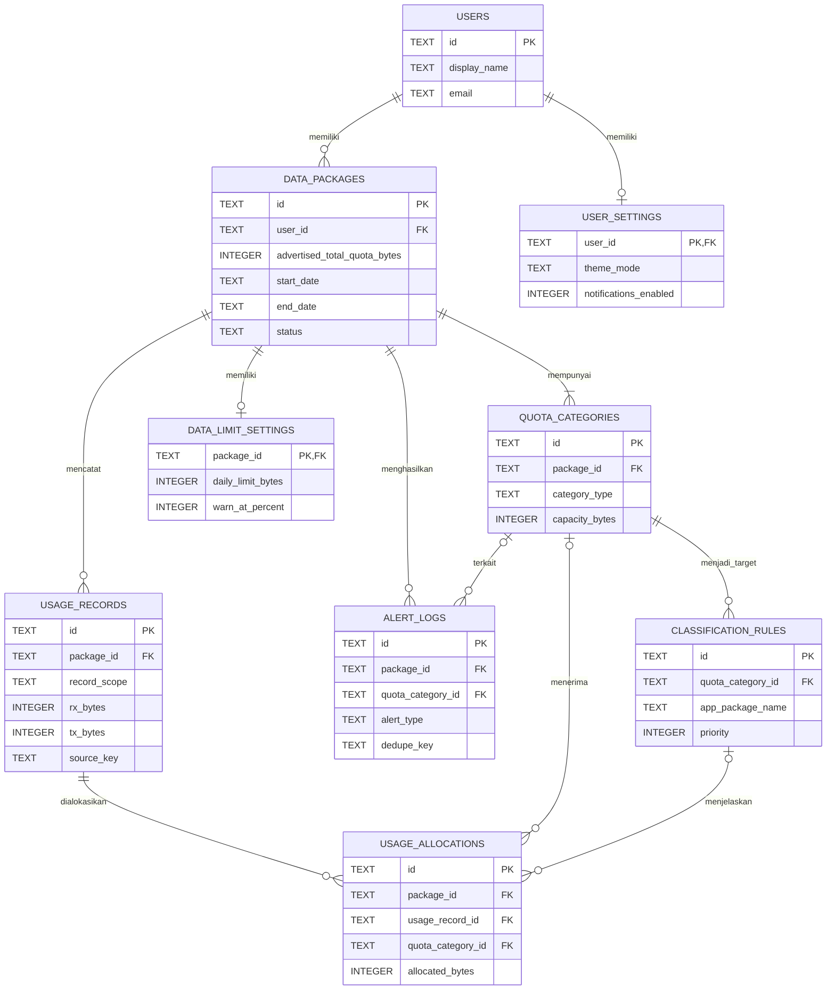
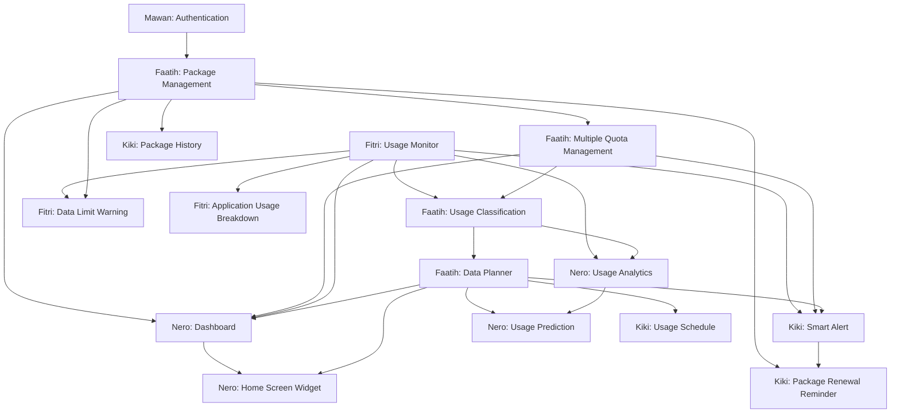

# DATAWISE

**Product Requirements Document (PRD)**  
**Versi:** 1.0 - Baseline untuk implementasi  
**Tanggal:** 12 November 2026  
**Platform:** Android  
**Framework:** Flutter dan Dart  
**Tim:** Faatih, Mawan, Kiki, Nero, Fitri  
**Durasi rencana:** 5 minggu pengerjaan inti, dilanjutkan persiapan demonstrasi sesuai jadwal kelas.

> **Status dokumen:** Baseline kerja tim. Isi dokumen ini menggabungkan keputusan fitur, alur, teknologi, rancangan database, pembagian anggota, ketergantungan pekerjaan, dan jadwal yang sudah dibahas. Detail implementasi boleh disempurnakan melalui kesepakatan tim, tetapi perubahan terhadap ruang lingkup MVP, aturan kuota, skema data, atau kontrak antarfitur harus dicatat.

## Ringkasan keputusan utama

1. DATAWISE adalah aplikasi Android untuk mengelola paket internet dan membantu pengguna mengatur pemakaian kuota.
2. Versi pertama memiliki 11 fitur MVP dan 9 fitur pengembangan berikutnya.
3. Pengguna hanya boleh memiliki satu paket berstatus aktif pada satu waktu.
4. Data transaksi dan pemakaian disimpan secara lokal di SQLite. Firebase Authentication hanya menangani identitas dan sesi login. Firestore tidak digunakan pada MVP.
5. Android membaca statistik penggunaan melalui `NetworkStatsManager` dengan izin Usage Access. Data yang diperoleh merupakan statistik perangkat, bukan catatan pemotongan kuota resmi operator.
6. Pembagian kuota utama, malam, sosial, dan kategori lain merupakan estimasi berbasis aturan aplikasi dan waktu.
7. Aplikasi memberi rekomendasi dan peringatan. Aplikasi tidak mematikan data seluler, membatasi kecepatan, atau memblokir aplikasi secara otomatis.
8. Faatih memegang fondasi pengelolaan paket, kategori, klasifikasi, dan Data Planner. Anggota lain dapat mengerjakan UI atau fungsi awal menggunakan data contoh sambil menunggu kontrak data.
9. Database dan UI/UX merupakan pekerjaan bersama di luar empat fitur kepemilikan masing-masing anggota.

---

# 1. Latar belakang dan tujuan produk

## 1.1 Masalah yang ingin diselesaikan

Pengguna paket internet sering memiliki batas kuota dan masa aktif. Pengguna perlu memperkirakan berapa banyak data yang aman digunakan setiap hari agar paket tidak cepat habis. Beberapa paket juga memiliki pembagian kuota, misalnya kuota utama, malam, sosial, atau aplikasi tertentu.

Informasi pemakaian dari pengaturan Android dapat membantu pengguna melihat aplikasi yang memakai data. Namun, statistik Android tidak otomatis mengetahui aturan pemotongan kuota operator. Karena itu, pengguna tetap membutuhkan alat untuk mengelola paket dan membuat perkiraan penggunaan.

## 1.2 Tujuan DATAWISE

DATAWISE bertujuan untuk:

- menyimpan informasi paket internet dan masa aktifnya;
- mengelola beberapa kategori kuota dalam satu paket;
- membaca statistik penggunaan data seluler perangkat jika izin tersedia;
- menampilkan penggunaan berdasarkan aplikasi;
- memperkirakan kategori kuota yang mungkin terpakai berdasarkan aturan aplikasi dan waktu;
- menghitung target penggunaan harian dan mingguan;
- memberikan peringatan ketika penggunaan mendekati atau melewati batas;
- menyimpan riwayat paket agar pengguna dapat membandingkan pemakaian sebelumnya.

## 1.3 Bukan tujuan DATAWISE

DATAWISE tidak bertujuan untuk:

- mengambil data pemotongan kuota langsung dari operator;
- menjamin bahwa estimasi kuota utama, malam, atau sosial sama dengan catatan operator;
- mematikan data seluler secara otomatis;
- memblokir aplikasi saat kuota mencapai batas;
- melakukan pemantauan paket data secara real-time;
- menyediakan sinkronisasi database antarperangkat pada MVP;
- menggunakan Machine Learning untuk klasifikasi kuota pada MVP.

## 1.4 Pengguna sasaran

Pengguna Android yang ingin mencatat paket internet, melihat pola penggunaan data, dan memperoleh rekomendasi pemakaian berdasarkan kapasitas serta masa aktif paket.

## 1.5 Ukuran keberhasilan produk

MVP dianggap berhasil jika pengguna dapat menyelesaikan alur berikut tanpa bantuan pengembang:

1. Membuat akun atau login.
2. Menambahkan paket dan kategori kuota.
3. Mengaktifkan satu paket.
4. Memberikan Usage Access atau memakai pencatatan manual.
5. Melihat ringkasan penggunaan dan sisa kuota estimasi.
6. Melihat target penggunaan harian.
7. Menerima peringatan batas penggunaan.
8. Membuka riwayat paket setelah paket berakhir.

---

# 2. Ruang lingkup fitur

## 2.1 Fitur MVP

Semua fitur berikut menjadi sasaran versi pertama. Urutan prioritas pengerjaan tetap mengikuti ketergantungan teknis dan jadwal pada Bagian 14.

| ID | Fitur | Pemilik | Kebutuhan utama | Keluaran yang terlihat pengguna |
|---|---|---|---|---|
| MVP-01 | Authentication | Mawan | Register, login, logout, validasi email/password, dan pemulihan sesi. | Pengguna dapat masuk ke akun dan kembali ke sesi yang tersimpan. |
| MVP-02 | Package Management | Faatih | Tambah, edit, hapus, aktifkan, dan arsipkan paket. | Daftar paket, detail kuota, operator, tanggal mulai, dan tanggal akhir. |
| MVP-03 | Multiple Quota Management | Faatih | Mengelola kuota utama, malam, sosial, aplikasi khusus, dan kategori khusus. | Setiap kategori memiliki kapasitas, sisa estimasi, dan masa berlaku. |
| MVP-04 | Usage Monitor | Fitri | Membaca statistik data seluler Android dan menyimpan catatan penggunaan. | Penggunaan data perangkat dan rincian per aplikasi jika data tersedia. |
| MVP-05 | Usage Classification | Faatih | Memperkirakan kategori penggunaan berdasarkan aplikasi dan waktu. | Estimasi pemakaian per kategori serta jumlah yang belum terklasifikasi. |
| MVP-06 | Data Planner | Faatih | Menghitung target harian dan mingguan dari kuota dan sisa hari. | Target penggunaan dan rekomendasi yang berubah mengikuti pemakaian. |
| MVP-07 | Dashboard | Nero | Menampilkan ringkasan paket, pemakaian, target, kategori, dan peringatan. | Satu halaman ringkasan kondisi paket aktif. |
| MVP-08 | Smart Alert | Kiki | Memberi notifikasi untuk target, kuota rendah, dan masa aktif. | Notifikasi lokal sesuai kondisi yang dipilih. |
| MVP-09 | Package History | Kiki | Menampilkan paket terdahulu dan ringkasan pemakaiannya. | Daftar paket selesai/arsip beserta detailnya. |
| MVP-10 | Settings | Mawan | Mengatur akun, izin, notifikasi, dan pilihan tema Light/Dark. | Halaman pengaturan akun dan aplikasi. |
| MVP-11 | Data Limit Warning | Fitri | Menentukan batas penggunaan harian dan memberi peringatan. | Peringatan saat mendekati dan melewati batas. |

### Batas minimum setiap fitur MVP

**Authentication**
- Register menggunakan email dan password.
- Login dan logout.
- Menampilkan pesan kesalahan yang dapat dipahami.
- Mengikuti status sesi Firebase Authentication.
- Tidak menyimpan password di SQLite.

**Package Management**
- Nama paket dan operator.
- Kuota paket yang tertera.
- Tanggal mulai dan tanggal berakhir.
- Status paket.
- Maksimal satu paket berstatus `ACTIVE` untuk satu pengguna.
- Paket lama tidak dihapus otomatis ketika masa aktif berakhir.

**Multiple Quota Management**
- Kategori utama wajib tersedia untuk setiap paket.
- Kategori tambahan dapat berupa malam, sosial, aplikasi khusus, atau kategori buatan pengguna.
- Setiap kategori memiliki kapasitas dan masa berlaku.
- Sisa kategori dihitung dari kapasitas dikurangi alokasi penggunaan yang tersimpan.
- Kategori tidak boleh mengurangi satu penggunaan yang sama secara bersamaan.

**Usage Monitor**
- Memeriksa status Usage Access.
- Membaca statistik jaringan seluler.
- Menyimpan periode data, UID aplikasi bila tersedia, RX, TX, dan sumber data.
- Menampilkan waktu pembaruan terakhir.
- Menyediakan input manual jika pembacaan otomatis tidak tersedia.
- Tidak menjalankan query statistik berat di UI thread.

**Usage Classification**
- Aturan dapat menyebut aplikasi tertentu atau semua aplikasi.
- Aturan dapat memiliki rentang waktu dan prioritas.
- Prioritas lebih tinggi menang ketika beberapa aturan cocok.
- Penggunaan tanpa aturan masuk ke kuota utama jika tersedia. Jika tidak ada kategori yang sesuai, penggunaan ditandai tidak terklasifikasi.
- Hasil selalu dilabeli sebagai estimasi.

**Data Planner**
- Menghitung target per hari dari sisa kuota dan sisa hari.
- Menghitung target mingguan dari target harian dan jumlah hari dalam periode tersebut.
- Memperbarui rekomendasi setelah data penggunaan bertambah.
- Tidak memaksa pengguna membatasi pemakaian.
- Target kategori tambahan dihitung terpisah sesuai kapasitas dan masa berlaku kategori.

**Dashboard**
- Menampilkan paket aktif dan tanggal berakhir.
- Menampilkan kuota utama, penggunaan, sisa estimasi, dan target harian.
- Menampilkan ringkasan kategori lain secara terpisah.
- Menampilkan status izin dan waktu pemutakhiran statistik.
- Menandai data yang merupakan estimasi atau input manual.

**Smart Alert dan Data Limit Warning**
- Notifikasi lokal, bukan SMS atau notifikasi operator.
- Peringatan dapat dinonaktifkan di Settings.
- Sistem mencegah notifikasi identik terkirim berulang untuk periode yang sama.
- Data Limit Warning memakai batas harian yang ditentukan pengguna atau batas harian dari Data Planner.
- Ambang awal yang disarankan adalah 80% untuk peringatan awal dan 100% untuk batas tercapai. Pengguna dapat mengubah pengaturan jika implementasi UI mendukungnya.

**Package History**
- Paket kedaluwarsa atau yang tidak aktif tetap tersimpan.
- Riwayat dapat dibuka tanpa mengubah status paket.
- Rincian penggunaan tetap mengacu ke paket lama.

**Settings**
- Informasi akun.
- Status izin Usage Access dan notifikasi.
- Pilihan Light Theme atau Dark Theme.
- Pengaturan notifikasi.

## 2.2 Fitur pengembangan berikutnya

Fitur berikut tetap masuk dalam peta produk dan penugasan, tetapi tidak boleh menghambat penyelesaian MVP.

| ID | Fitur | Pemilik | Gambaran fungsi | Ketentuan |
|---|---|---|---|---|
| FUT-01 | Usage Prediction | Nero | Memperkirakan kapan kuota akan habis dari pola penggunaan sebelumnya. | Perkiraan hanya layak ditampilkan jika data historis cukup. |
| FUT-02 | Usage Analytics | Nero | Analisis tren harian, mingguan, dan kategori penggunaan. | Mengolah data sumber yang sudah tersimpan. |
| FUT-03 | Custom Theme | Mawan | Pengguna memilih atau membuat kombinasi warna. | MVP hanya menyediakan Light dan Dark. |
| FUT-04 | Internet Settings Shortcut | Fitri | Membuka halaman pengaturan jaringan Android. | Tidak mengubah pengaturan secara diam-diam. |
| FUT-05 | Application Usage Breakdown | Fitri | Rincian aplikasi lebih lengkap, periode, dan perbandingan penggunaan. | MVP tetap menyediakan ringkasan aplikasi dasar dari Usage Monitor. |
| FUT-06 | Usage Schedule | Kiki | Jadwal target atau pengingat penggunaan berdasarkan waktu. | Tidak menjadwalkan pemutusan koneksi. |
| FUT-07 | Package Renewal Reminder | Kiki | Pengingat sebelum masa aktif paket berakhir. | Dapat menggunakan tanggal paket dan sistem alert yang sudah ada. |
| FUT-08 | Data Export & Backup | Mawan | Ekspor data ke file dan mekanisme backup. | Tidak ada cloud sync pada MVP. |
| FUT-09 | Home Screen Widget | Nero | Ringkasan kuota pada layar utama Android. | Menggunakan sumber data yang sama dengan Dashboard. |

## 2.3 Prioritas dan batas waktu

Urutan prioritas:

- **P0:** Authentication, struktur database, Package Management, kategori kuota, dan kontrak data.
- **P1:** Usage Monitor, Usage Classification, Data Planner, Dashboard dasar.
- **P2:** Smart Alert, Data Limit Warning, Package History, Settings.
- **P3:** Penyempurnaan UI, grafik, dan fitur pengembangan berikutnya.

Jika waktu tidak cukup, fitur FUT-* ditunda. Fitur MVP tidak boleh dikorbankan untuk menyelesaikan widget, prediksi, atau tema khusus.

---

# 3. Alur penggunaan aplikasi

## 3.1 Alur pengguna baru

```text
Buka DATAWISE
   |
   v
Register / Login
   |
   v
Periksa sesi dan profil pengguna
   |
   v
Penjelasan fitur pemantauan + permintaan izin
   |
   +---- Izin Usage Access diberikan ----+
   |                                     |
   |                                     v
   |                              Pemantauan otomatis
   |
   +---- Izin belum diberikan ----------+
                                         |
                                         v
                                  Input manual sebagai fallback
   |
   v
Tambah paket internet
   |
   v
Buat kategori kuota
   |
   v
Aktifkan satu paket
   |
   v
Dashboard
   |
   v
Monitor -> Classification -> Planner -> Alert
```

## 3.2 Alur pengguna yang sudah memiliki akun

1. Aplikasi memeriksa sesi Firebase Authentication.
2. Jika sesi valid, aplikasi membuka data lokal milik UID tersebut.
3. Aplikasi memeriksa status paket aktif dan tanggal kedaluwarsa.
4. Aplikasi memperbarui statistik jika izin tersedia.
5. Dashboard menampilkan data terakhir dan waktu pemutakhiran.

## 3.3 Kondisi khusus

| Kondisi | Perilaku yang diharapkan |
|---|---|
| Belum ada paket | Dashboard menampilkan ajakan menambahkan paket. |
| Tidak ada koneksi internet | Data lokal dan perhitungan tetap tersedia. Login baru tetap membutuhkan koneksi. |
| Usage Access belum diberikan | Tampilkan petunjuk ke pengaturan Android dan aktifkan input manual. |
| Pengambilan statistik gagal | Tampilkan waktu pembaruan terakhir dan pesan kegagalan. Jangan menghapus statistik lama. |
| Paket kedaluwarsa | Ubah status menjadi `EXPIRED`, hentikan perhitungan paket aktif, dan pertahankan riwayat. |
| Paket baru diaktifkan | Paket aktif sebelumnya menjadi `INACTIVE`; paket baru menjadi `ACTIVE`. |
| Pengguna berganti akun | Semua query lokal dibatasi ke Firebase UID akun aktif. Jangan mencampur data antarakun. |
| Kategori kuota habis | Tampilkan sisa 0 dan kelebihan estimasi jika pemakaian masih dialokasikan ke kategori tersebut. Jangan otomatis memindahkan pemotongan ke kategori lain. |

---

# 4. Aturan bisnis dan rumus perhitungan

## 4.1 Satuan penyimpanan

Semua kapasitas dan penggunaan disimpan dalam byte menggunakan tipe `INTEGER`. Timestamp peristiwa disimpan sebagai ISO-8601 UTC (akhiran `Z`). Tanggal mulai/akhir paket disimpan sebagai tanggal kalender lokal `YYYY-MM-DD`. Aturan jam dibaca menggunakan `timezone_id` pengguna/perangkat.

- 1 GB = 1.000.000.000 byte.
- 1 MB = 1.000.000 byte.
- Jangan mencampur GB desimal dengan GiB biner dalam rumus yang sama.
- Konversi ke GB/MB dilakukan pada lapisan tampilan.

## 4.2 Paket dan kategori kuota

Setiap paket memiliki satu atau lebih kategori kuota. Kategori `MAIN` wajib ada. Kategori lain dapat berupa `NIGHT`, `SOCIAL`, `APP_SPECIFIC`, atau `CUSTOM`.

`advertised_total_quota_bytes` pada `data_packages` menyimpan angka total yang tertera pada paket sebagai informasi. Kapasitas masing-masing kategori pada `quota_categories` menjadi sumber perhitungan sisa kategori.

Jika operator memberikan 15 GB utama, 5 GB malam, dan 5 GB sosial, maka DATAWISE menyimpan tiga kategori dengan kapasitas masing-masing. Jangan membuat satu catatan 25 GB di kategori utama lalu menambahkan lagi 5 GB malam dan 5 GB sosial, karena itu akan menggandakan kuota.

Jika pengguna hanya mengetahui total 20 GB tanpa pembagian, sistem membuat satu kategori `MAIN` sebesar 20 GB.

Jika jumlah kategori berbeda dari total yang tertera, aplikasi menampilkan konfirmasi/peringatan. Angka total paket tidak boleh otomatis dijumlahkan lagi ke saldo kategori.

## 4.3 Sisa kuota kategori

Untuk setiap kategori:

`used_bytes = SUM(usage_allocations.allocated_bytes untuk kategori tersebut)`

`remaining_bytes = MAX(capacity_bytes - used_bytes, 0)`

`overused_bytes = MAX(used_bytes - capacity_bytes, 0)`

Remaining dihitung dari catatan alokasi. Jangan menyimpan angka sisa sebagai sumber data utama karena dapat tidak sinkron dengan catatan penggunaan.

## 4.4 Target penggunaan harian

Contoh:

- Kuota utama tersisa: 20 GB.
- Hari tersisa sampai paket berakhir: 10 hari.

`target_harian = remaining_main_bytes / remaining_days`

Hasil awal: 2 GB per hari. Untuk paket yang masih aktif, sisa hari dihitung inklusif dengan rumus `max(0, (end_date - tanggal_lokal_hari_ini).days + 1)`. Jika hari ini adalah tanggal akhir paket, berarti masih ada 1 hari kalender. Jika hasil 0, paket dianggap kedaluwarsa.

Jika pada hari pertama pengguna menggunakan 3 GB, sisa kuota menjadi 17 GB dan sisa hari menjadi 9 hari.

`target_baru = 17 GB / 9 = sekitar 1,89 GB per hari`

Ketentuan:

- Perhitungan hari menggunakan tanggal lokal perangkat.
- Jika sisa hari 0, target harian tidak dihitung dan paket ditandai kedaluwarsa.
- Jika sisa kuota 0, target menjadi 0.
- Jika target hasil pembagian memiliki pecahan byte, simpan hasil dalam angka desimal untuk tampilan atau pembulatan byte pada proses perhitungan. Jangan mengubah sumber kapasitas.

## 4.5 Target mingguan

`target_mingguan = target_harian x jumlah_hari_periode`

Periode standar adalah 7 hari. Untuk sisa masa aktif kurang dari 7 hari, gunakan `min(7, remaining_days)`. Jadi target mingguan tidak boleh melampaui sisa periode paket.

Target mingguan merupakan rekomendasi. Sistem tidak mengunci pemakaian pengguna.

## 4.6 Target kategori tambahan

Setiap kategori tambahan dihitung sendiri berdasarkan sisa kapasitas dan sisa masa berlaku kategori tersebut. Jangan menjumlahkan kuota malam dan sosial ke target kuota utama tanpa mempertimbangkan aturan aplikasi dan waktu.

## 4.7 Usage Classification

Urutan klasifikasi:

1. Ambil catatan penggunaan seluler dari Usage Monitor.
2. Identifikasi aplikasi melalui package name/UID jika tersedia.
3. Ambil waktu bucket penggunaan.
4. Cari aturan yang cocok berdasarkan aplikasi, rentang waktu, dan hari.
5. Pilih aturan dengan nilai `priority` tertinggi.
6. Jika prioritas sama, aturan aplikasi spesifik menang atas aturan semua aplikasi.
7. Jika tidak ada aturan yang cocok, alokasikan ke kategori `MAIN` jika tersedia.
8. Jika kategori utama tidak tersedia, simpan alokasi sebagai `UNCLASSIFIED`.
9. Simpan hasil alokasi secara terpisah dari catatan penggunaan asli.

Aturan waktu menggunakan menit sejak tengah malam. `start_minute` termasuk dalam rentang, `end_minute` tidak termasuk. Rentang yang melewati tengah malam diperbolehkan, misalnya 22:00 sampai 06:00.

Jika satu bucket Android mencakup dua jendela waktu, DATAWISE tidak mengetahui pembagian byte secara persis. Untuk baseline MVP, sistem memakai waktu titik tengah bucket sebagai waktu representatif, lalu memilih aturan berdasarkan titik tersebut. Hasil wajib diberi label estimasi.

## 4.8 Contoh aturan klasifikasi

| Nama aturan | Aplikasi | Waktu | Prioritas | Kategori |
|---|---|---|---:|---|
| Malam untuk semua aplikasi | Semua aplikasi | 00:00-06:00 | 100 | NIGHT |
| Instagram siang | `com.instagram.android` | 06:00-24:00 | 50 | SOCIAL |
| YouTube siang | `com.google.android.youtube` | 06:00-24:00 | 50 | APP_SPECIFIC atau CUSTOM |

Dengan contoh ini:

- Instagram pada pukul 01:00 cocok dengan aturan malam, sehingga perkiraan masuk NIGHT.
- Instagram pada pukul 14:00 cocok dengan aturan Instagram siang, sehingga perkiraan masuk SOCIAL.
- Aplikasi yang tidak cocok dengan aturan apa pun masuk MAIN jika tersedia.

Aturan contoh bukan klaim tentang cara operator memotong kuota. Pengguna perlu menyesuaikannya dengan ketentuan paket yang dimilikinya.

## 4.9 Data Limit Warning

- Pengguna dapat menetapkan batas harian sendiri.
- Jika pengguna tidak menetapkan batas khusus, sistem dapat menggunakan target Data Planner.
- Ambang awal: 80% untuk notifikasi mendekati batas dan 100% untuk batas tercapai. Untuk Smart Alert MVP, batas kuota rendah default adalah sisa kuota MAIN 20% atau kurang, sedangkan peringatan paket berakhir dikirim satu hari kalender sebelum `end_date`.
- Pada mode otomatis, batas total harian menggunakan `DEVICE_TOTAL` jika tersedia. Jika tidak tersedia, gunakan total per UID dari `APP_USAGE`. Jangan menjumlahkan keduanya. Pada mode manual, gunakan `MANUAL_TOTAL`.
- `DEVICE_TOTAL` hanya menjadi pembanding untuk kualitas rincian aplikasi. Selisihnya tidak otomatis dibagi ke kategori.
- Sistem memeriksa penggunaan pada saat data diperbarui dan ketika aplikasi dibuka.
- Tidak ada pemutusan koneksi otomatis.
- Notifikasi harus memiliki kunci deduplikasi agar tidak berulang pada hari dan batas yang sama.

## 4.10 Smart Alert

Jenis peringatan MVP:

- target harian tercapai atau terlampaui;
- sisa kuota utama di bawah ambang tertentu;
- batas harian hampir tercapai atau sudah tercapai;
- paket mendekati tanggal berakhir.

Notifikasi hanya dikirim jika pengaturan notifikasi aktif. Riwayat notifikasi disimpan di `alert_logs`.

## 4.11 Package History

Tidak perlu membuat tabel `package_history` terpisah. Riwayat berasal dari baris `data_packages` yang statusnya `INACTIVE`, `EXPIRED`, atau `ARCHIVED`. Data penggunaan dan kategori tetap terhubung ke `package_id` yang sama.

---

# 5. Pemantauan penggunaan data Android

## 5.1 Teknologi

Pemantauan menggunakan Android `NetworkStatsManager` melalui Kotlin dan dihubungkan ke Flutter memakai `MethodChannel`.

Android menyediakan statistik jaringan berdasarkan interval waktu dan bucket. Akses ke statistik aplikasi lain memerlukan izin khusus `PACKAGE_USAGE_STATS` yang pengguna aktifkan melalui halaman Usage Access di pengaturan perangkat. Statistik dapat membutuhkan beberapa detik dan harus diambil di worker/background thread, bukan UI thread. [R1][R2]

## 5.2 Hal yang dapat dibaca

- Statistik penggunaan jaringan seluler untuk rentang waktu tertentu.
- Ringkasan penggunaan berdasarkan UID aplikasi.
- Statistik agregat perangkat/pengguna.
- RX bytes (data diterima) dan TX bytes (data dikirim).
- Rentang awal dan akhir bucket statistik.

Nama aplikasi dan package name dipetakan dari UID melalui informasi paket Android jika tersedia. Beberapa UID dapat mewakili lebih dari satu package atau aplikasi sistem. Karena itu, rincian per aplikasi bisa tidak sempurna.

## 5.3 Batas teknis yang wajib dipahami tim

1. Statistik Android bukan angka pemotongan kuota operator.
2. Bucket statistik berada pada skala waktu jam, sehingga tidak cocok untuk mengukur penggunaan dalam detik atau real-time. [R2]
3. Android dapat membatasi akses ke subscriber ID pada versi tertentu. Pengambilan statistik seluler dapat perlu dilakukan secara agregat untuk seluruh jaringan seluler yang dapat dibaca aplikasi. Jangan menjanjikan pemisahan kuota per SIM. [R2]
4. Usage Access bukan izin runtime biasa. Aplikasi harus mengarahkan pengguna ke halaman pengaturan yang sesuai.
5. WorkManager memiliki interval minimum pekerjaan berkala 15 menit. Android dapat menunda eksekusinya sesuai kondisi sistem, sehingga interval tersebut bukan jaminan pembaruan tepat waktu. [R3]
6. Ketika izin dicabut, pemantauan otomatis berhenti dan aplikasi harus beralih ke mode manual tanpa menghapus data lama.
7. Jika pengguna melakukan reset statistik perangkat, mengganti SIM, atau mengubah konfigurasi jaringan, hasil perbandingan dapat berubah. UI harus menampilkan waktu pembaruan dan status sumber data. Jika statistik agregat perangkat dan jumlah per aplikasi berbeda, tampilkan selisihnya sebagai informasi kualitas data. Jangan mengalokasikan DEVICE_TOTAL sekali lagi karena itu akan menggandakan pemakaian.

## 5.4 Frekuensi pemutakhiran

- Saat aplikasi dibuka: jalankan sinkronisasi statistik terbaru.
- Saat aplikasi berada di latar belakang: gunakan pekerjaan berkala best-effort dengan WorkManager.
- Interval konfigurasi tidak boleh kurang dari 15 menit untuk periodic work.
- UI menampilkan `last_updated_at`.
- Jangan menuliskan janji "real-time" atau "selalu diperbarui setiap 15 menit".

## 5.5 Pencegahan data ganda

Setiap bucket Android harus memiliki `source_key` deterministik, misalnya gabungan dari scope, tipe jaringan, UID, awal bucket, dan akhir bucket.

Jika bucket yang sama dibaca kembali:

- jangan memasukkan baris penggunaan baru;
- perbarui nilai RX/TX pada baris yang memiliki `source_key` sama;
- hitung ulang alokasi terkait dalam satu transaksi SQLite;
- jangan menjumlahkan ulang nilai lama dengan nilai pembaruan baru.

Untuk pemantauan agregat perangkat dan data per aplikasi, gunakan `record_scope` yang berbeda. Jangan menjumlahkan catatan agregat perangkat dan catatan per aplikasi dalam satu total karena keduanya dapat menggambarkan pemakaian yang sama.

## 5.6 Mode manual

Jika Usage Access tidak diberikan:

- pengguna dapat memasukkan jumlah pemakaian pada tanggal tertentu;
- pengguna dapat memilih kategori atau menandainya tidak terklasifikasi;
- sumber dicatat sebagai `MANUAL`;
- aplikasi menampilkan label "Input manual";
- aplikasi memperingatkan pengguna agar tidak memasukkan ulang jumlah yang sudah tercatat otomatis pada periode yang sama.

---

# 6. UI/UX dan navigasi

## 6.1 Navigasi utama

Gunakan Bottom Navigation Bar dengan lima bagian:

| Tab | Isi |
|---|---|
| Dashboard | Ringkasan paket aktif, penggunaan, sisa, target, dan peringatan. |
| Packages | Daftar paket, tambah/edit paket, dan kategori kuota. |
| Planner | Target harian/mingguan dan rekomendasi penggunaan. |
| History | Paket terdahulu dan rincian penggunaan. |
| Settings | Akun, izin, notifikasi, dan tema. |

## 6.2 Halaman Dashboard

Urutan informasi yang disarankan:

1. Nama paket aktif dan masa berlaku.
2. Sisa kuota utama dan persentase pemakaian.
3. Target penggunaan harian.
4. Grafik penggunaan beberapa hari terakhir.
5. Ringkasan kuota malam/sosial/kategori khusus.
6. Aplikasi dengan penggunaan tertinggi.
7. Peringatan dan waktu statistik terakhir diperbarui.

Jangan mencampur total kuota yang tertera dengan penjumlahan kategori jika kategori tersebut dapat tumpang tindih atau tidak setara.

## 6.3 Tema

MVP menyediakan dua tema:

- Light Theme: dominan biru dan putih.
- Dark Theme: dominan hitam/gelap dan hijau terang.

Custom Theme dan pemilihan palet secara bebas masuk pengembangan berikutnya.

## 6.4 Grafik

Gunakan `fl_chart` untuk kebutuhan grafik MVP:

- Line Chart untuk penggunaan harian.
- Bar Chart untuk perbandingan penggunaan harian/mingguan atau per aplikasi.
- Pie/Donut-style chart untuk komposisi kategori jika data kategori tersedia.
- Circular progress dapat menggunakan widget Flutter bawaan dan tidak memerlukan library grafik tambahan.

Jika library berubah, jangan mengikat business logic ke komponen grafik. Provider cukup menyediakan data yang siap ditampilkan.

---

# 7. Arsitektur aplikasi dan teknologi

## 7.1 Arsitektur lapisan

```text
Flutter UI (Screen / Widget)
           |
           v
Provider (State Management)
           |
           v
Service / Repository (Business Logic + Data Access)
           |
   +-------+-------------+-----------------+
   |                     |                 |
   v                     v                 v
SQLite               Firebase Auth     Android Kotlin
(local database)     (identity/session) (NetworkStatsManager)
                                           |
                                           v
                                      MethodChannel

Service / Repository -> WorkManager -> Local Notification
```

Aturan arsitektur:

- UI tidak boleh mengakses SQLite langsung.
- UI tidak boleh memanggil MethodChannel langsung.
- Provider memanggil Service/Repository.
- Business logic perhitungan berada di service, bukan di widget.
- SQLite merupakan sumber data utama untuk paket, kategori, pemakaian, aturan, dan riwayat.
- Firebase Authentication menangani identitas, bukan penyimpanan seluruh data paket.

## 7.2 Teknologi yang ditetapkan

| Bagian | Teknologi | Tanggung jawab |
|---|---|---|
| Bahasa aplikasi | Dart | Logika Flutter dan fitur utama. |
| Framework | Flutter | Antarmuka Android. |
| State management | Provider | Mengelola state dan memperbarui UI. |
| Database lokal | SQLite melalui `sqflite` | Menyimpan data terstruktur secara offline. |
| Path database | `path` | Membentuk path file database. |
| Authentication | Firebase Authentication | Register, login, logout, dan sesi. |
| Integrasi native | Kotlin + MethodChannel | Memanggil API statistik Android. |
| Pemantauan latar belakang | WorkManager | Menjadwalkan pembaruan best-effort. |
| Notifikasi lokal | `flutter_local_notifications` | Menampilkan peringatan lokal. |
| Grafik | `fl_chart` | Grafik penggunaan dan kategori. |
| Preferensi sederhana | SQLite `user_settings` | Menyimpan tema dan pilihan pengguna. |

Tidak ada Firestore atau Supabase pada MVP. Penambahan database cloud membutuhkan keputusan sinkronisasi, konflik data, dan keamanan yang terpisah.

## 7.3 Platform target

- Android 8.0 (API 26) atau lebih baru sebagai target minimum proyek.
- Pengujian utama harus memakai perangkat Android fisik dengan SIM dan data seluler.
- Emulator boleh dipakai untuk mengembangkan UI dan alur umum, tetapi tidak cukup untuk membuktikan pemantauan data seluler.

---

# 8. Rancangan database SQLite

Bagian ini wajib dibaca sebelum implementasi database. Rancangan berikut adalah baseline relasional untuk MVP. Tujuannya agar setiap anggota menggunakan nama tabel, kolom, dan hubungan yang sama.

## 8.1 Prinsip desain database

1. SQLite menjadi database operasional lokal.
2. `users.id` menggunakan UID Firebase Authentication.
3. Semua paket dimiliki oleh satu user melalui `data_packages.user_id`.
4. Semua tabel anak terhubung ke `data_packages` melalui `package_id` atau kategori terkait.
5. Kapasitas dan penggunaan disimpan dalam byte (`INTEGER`).
6. Sisa kuota dihitung dari kapasitas dikurangi alokasi, bukan dijadikan sumber kebenaran tersendiri.
7. Catatan penggunaan asli dipisah dari hasil klasifikasi.
8. Riwayat paket menggunakan `data_packages`, bukan tabel duplikat.
9. Dashboard, Analytics, dan Application Breakdown dibentuk dari query terhadap tabel sumber, bukan disimpan sebagai tabel duplikat pada MVP.
10. SQLite foreign key harus diaktifkan menggunakan `PRAGMA foreign_keys = ON` pada koneksi database.

## 8.2 Diagram relasi antartabel



### Cara membaca panah relasi

- `USERS 1 -> banyak DATA_PACKAGES`: satu user dapat menyimpan banyak paket.
- `DATA_PACKAGES 1 -> banyak QUOTA_CATEGORIES`: satu paket mempunyai kategori utama dan kategori tambahan.
- `DATA_PACKAGES 1 -> banyak USAGE_RECORDS`: satu paket memiliki banyak catatan penggunaan.
- `USAGE_RECORDS 1 -> banyak USAGE_ALLOCATIONS`: satu catatan penggunaan dapat dibagi ke beberapa kategori jika aturan pembagian memang diperlukan. Untuk versi awal, umumnya satu catatan masuk ke satu kategori.
- `QUOTA_CATEGORIES 1 -> banyak CLASSIFICATION_RULES`: satu kategori dapat memiliki beberapa aturan aplikasi/waktu.
- `QUOTA_CATEGORIES 1 -> banyak USAGE_ALLOCATIONS`: kategori menerima banyak alokasi penggunaan.
- `DATA_PACKAGES 1 -> 0 atau 1 DATA_LIMIT_SETTINGS`: setiap paket boleh memiliki satu konfigurasi batas harian.
- `USERS 1 -> 0 atau 1 USER_SETTINGS`: satu user memiliki satu baris pengaturan.
- `DATA_PACKAGES 1 -> banyak ALERT_LOGS`: satu paket dapat menghasilkan banyak riwayat peringatan.

## 8.3 Tabel 1: `users`

**Fungsi:** Menyimpan profil lokal yang merujuk ke akun Firebase Authentication.

| Kolom | Tipe | Aturan | Keterangan |
|---|---|---|---|
| `id` | TEXT | PK, NOT NULL | UID dari Firebase Authentication. |
| `display_name` | TEXT | NULL diperbolehkan | Nama tampilan pengguna. |
| `email` | TEXT | NULL diperbolehkan | Email akun sebagai salinan informasi. |
| `created_at` | TEXT | NOT NULL | Waktu profil lokal dibuat. |
| `updated_at` | TEXT | NOT NULL | Waktu profil terakhir diperbarui. |

Contoh isi:

| id | display_name | email |
|---|---|---|
| `uid_001` | Faatih Demo | faatih@example.test |

Catatan: password tidak boleh disimpan di tabel ini. Firebase Authentication menjadi tempat pengelolaan kredensial.

## 8.4 Tabel 2: `data_packages`

**Fungsi:** Menyimpan paket internet. Baris paket yang sudah berakhir tetap disimpan untuk riwayat. Penghapusan permanen hanya boleh dilakukan jika tidak ada catatan anak atau setelah pengguna mengonfirmasi penghapusan seluruh riwayat paket tersebut. Default yang disarankan adalah mengarsipkan, bukan menghapus.

| Kolom | Tipe | Aturan | Keterangan |
|---|---|---|---|
| `id` | TEXT | PK | ID paket, dibuat aplikasi. |
| `user_id` | TEXT | FK -> `users.id`, NOT NULL | Pemilik paket. |
| `package_name` | TEXT | NOT NULL | Nama paket. |
| `operator_name` | TEXT | NULL | Nama operator. |
| `advertised_total_quota_bytes` | INTEGER | NOT NULL, >= 0 | Total yang tertera pada paket, untuk informasi. |
| `start_date` | TEXT | NOT NULL | Tanggal mulai, format `YYYY-MM-DD`. |
| `end_date` | TEXT | NOT NULL | Tanggal akhir, format `YYYY-MM-DD`. |
| `status` | TEXT | NOT NULL | `ACTIVE`, `INACTIVE`, `EXPIRED`, atau `ARCHIVED`. |
| `created_at` | TEXT | NOT NULL | Waktu pembuatan. |
| `updated_at` | TEXT | NOT NULL | Waktu perubahan terakhir. |

Contoh isi:

```text
pkg_001
  user_id: uid_001
  package_name: Paket Bulanan 25 GB
  advertised_total_quota_bytes: 25000000000
  start_date: 2026-11-01
  end_date: 2026-11-30
  status: ACTIVE

pkg_002
  user_id: uid_001
  package_name: Paket Mingguan 10 GB
  advertised_total_quota_bytes: 10000000000
  start_date: 2026-10-01
  end_date: 2026-10-07
  status: EXPIRED
```

**Aturan penting:** hanya boleh ada satu paket dengan status `ACTIVE` per user. Gunakan partial unique index pada `user_id` untuk baris `status='ACTIVE'`.

## 8.5 Tabel 3: `quota_categories`

**Fungsi:** Menyimpan setiap kelompok kuota yang dapat dikurangi oleh hasil alokasi penggunaan.

| Kolom | Tipe | Aturan | Keterangan |
|---|---|---|---|
| `id` | TEXT | PK | ID kategori. |
| `package_id` | TEXT | FK -> `data_packages.id`, NOT NULL | Paket pemilik kategori. |
| `category_name` | TEXT | NOT NULL | Nama kategori yang terlihat pengguna. |
| `category_type` | TEXT | NOT NULL | `MAIN`, `NIGHT`, `SOCIAL`, `APP_SPECIFIC`, `CUSTOM`. |
| `capacity_bytes` | INTEGER | NOT NULL, >= 0 | Kapasitas kategori. |
| `valid_from` | TEXT | NULL | Tanggal mulai kategori. |
| `valid_until` | TEXT | NULL | Tanggal akhir kategori. |
| `is_enabled` | INTEGER | 0/1 | Apakah kategori digunakan. |
| `created_at` | TEXT | NOT NULL | Waktu dibuat. |

Contoh isi:

| id | package_id | category_name | category_type | capacity_bytes |
|---|---|---|---|---:|
| `cat_main` | `pkg_001` | Kuota Utama | MAIN | 15000000000 |
| `cat_night` | `pkg_001` | Kuota Malam | NIGHT | 5000000000 |
| `cat_social` | `pkg_001` | Kuota Sosial | SOCIAL | 5000000000 |

Pada contoh ini, total yang tertera 25 GB dibagi menjadi 15 GB utama, 5 GB malam, dan 5 GB sosial. Jangan membuat kategori utama sebesar 25 GB lalu menambahkan 10 GB kategori tambahan.

Aturan:

- Setiap paket harus memiliki tepat satu kategori `MAIN`.
- Gunakan unique partial index agar satu paket tidak mempunyai dua kategori `MAIN`.
- Kategori yang sudah memiliki alokasi jangan dihapus sembarangan. Nonaktifkan kategori atau lakukan migrasi data dengan transaksi.

## 8.6 Tabel 4: `usage_records`

**Fungsi:** Menyimpan hasil pembacaan Android atau input manual. Ini adalah catatan sumber dan tidak boleh ditimpa oleh hasil klasifikasi.

| Kolom | Tipe | Aturan | Keterangan |
|---|---|---|---|
| `id` | TEXT | PK | ID catatan penggunaan. |
| `package_id` | TEXT | FK -> `data_packages.id`, NOT NULL | Paket yang sedang dihitung. |
| `record_scope` | TEXT | NOT NULL | `APP_USAGE`, `DEVICE_TOTAL`, atau `MANUAL_TOTAL`. |
| `app_uid` | INTEGER | NULL | UID aplikasi Android jika tersedia. |
| `app_package_name` | TEXT | NULL | Contoh `com.instagram.android`. |
| `app_name` | TEXT | NULL | Nama aplikasi untuk tampilan. |
| `network_type` | TEXT | NOT NULL | `MOBILE`, `WIFI`, atau `UNKNOWN`. |
| `period_start_at` | TEXT | NOT NULL | Awal bucket/periode dalam ISO-8601 UTC. |
| `period_end_at` | TEXT | NOT NULL | Akhir bucket/periode dalam ISO-8601 UTC. |
| `rx_bytes` | INTEGER | NOT NULL, >= 0 | Data diterima. |
| `tx_bytes` | INTEGER | NOT NULL, >= 0 | Data dikirim. |
| `source` | TEXT | NOT NULL | `ANDROID` atau `MANUAL`. |
| `source_key` | TEXT | UNIQUE | Kunci unik bucket Android untuk mencegah data ganda. |
| `recorded_at` | TEXT | NOT NULL | Waktu aplikasi menyimpan/membaca data dalam UTC. |

Contoh isi:

```text
use_001
  package_id: pkg_001
  record_scope: APP_USAGE
  app_package_name: com.instagram.android
  network_type: MOBILE
  rx_bytes: 80000000
  tx_bytes: 20000000
  source: ANDROID

use_002
  package_id: pkg_001
  record_scope: APP_USAGE
  app_package_name: com.google.android.youtube
  network_type: MOBILE
  rx_bytes: 180000000
  tx_bytes: 20000000
  source: ANDROID

use_003
  package_id: pkg_001
  record_scope: DEVICE_TOTAL
  app_package_name: NULL
  network_type: MOBILE
  rx_bytes: 300000000
  tx_bytes: 50000000
  source: ANDROID
```

Catatan:

- `APP_USAGE` untuk statistik berdasarkan UID aplikasi. Jika ada UID yang tidak dapat dipetakan ke nama aplikasi, simpan barisnya dengan nama aplikasi NULL agar byte tidak hilang dari agregat per UID.
- `DEVICE_TOTAL` untuk statistik agregat perangkat. Ini hanya pembanding. Jangan menjumlahkannya dengan seluruh baris `APP_USAGE` dan jangan membuat alokasi kategori dari baris ini.
- `MANUAL_TOTAL` untuk input manual total pemakaian jika pemantauan otomatis tidak tersedia.
- Total byte sebuah catatan adalah `rx_bytes + tx_bytes`.
- Jika Android membaca bucket yang sama lagi, update berdasarkan `source_key`, jangan insert dan jumlahkan ulang. Jumlah APP_USAGE dipakai untuk rincian dan estimasi kategori. DEVICE_TOTAL hanya pembanding agregat, tidak dijumlahkan dengan APP_USAGE dan tidak dialokasikan ke kategori.
- `WIFI` tidak mengurangi kategori kuota paket seluler.

## 8.7 Tabel 5: `classification_rules`

**Fungsi:** Menentukan aplikasi dan waktu penggunaan yang diperkirakan masuk ke kategori tertentu.

| Kolom | Tipe | Aturan | Keterangan |
|---|---|---|---|
| `id` | TEXT | PK | ID aturan. |
| `quota_category_id` | TEXT | FK -> `quota_categories.id`, NOT NULL | Kategori tujuan. |
| `rule_name` | TEXT | NOT NULL | Nama aturan. |
| `app_package_name` | TEXT | NULL | Package name spesifik. NULL berarti semua aplikasi. |
| `start_minute` | INTEGER | NULL atau 0..1439 | Menit sejak tengah malam. |
| `end_minute` | INTEGER | NULL atau 0..1440 | Batas akhir waktu. Nilai 1440 berarti pukul 24:00. |
| `days_of_week_mask` | INTEGER | 1..127, default 127 | Hari yang berlaku. |
| `priority` | INTEGER | NOT NULL | Angka lebih besar berarti prioritas lebih tinggi. |
| `is_enabled` | INTEGER | 0/1 | Status aturan. |
| `created_at` | TEXT | NOT NULL | Waktu dibuat. |

Contoh isi:

```text
rule_night
  quota_category_id: cat_night
  rule_name: Semua aplikasi malam
  app_package_name: NULL (semua aplikasi)
  start_minute: 0 (00:00)
  end_minute: 360 (06:00)
  priority: 100

rule_instagram
  quota_category_id: cat_social
  rule_name: Instagram siang
  app_package_name: com.instagram.android
  start_minute: 360 (06:00)
  end_minute: 1440 (24:00)
  priority: 50
```

`start_minute=0` berarti pukul 00:00, `360` berarti 06:00, dan `1440` berarti pukul 24:00. Rentang yang melewati tengah malam, misalnya 22:00 sampai 06:00, memakai nilai awal lebih besar daripada nilai akhir. Fungsi pencocokan waktu harus menangani kondisi ini secara khusus.

Aturan lintas tengah malam, misalnya 22:00-06:00, harus ditangani secara eksplisit oleh fungsi pencocokan waktu. Jangan menggunakan perbandingan `start <= now < end` biasa untuk aturan tersebut. Bit `days_of_week_mask` ditetapkan dari Senin sebagai bit 0 sampai Minggu sebagai bit 6. Saat prioritas sama, aturan aplikasi spesifik menang dari aturan semua aplikasi. Jika masih sama, sistem memilih aturan dengan ID terkecil secara leksikografis agar hasil deterministik.

## 8.8 Tabel 6: `usage_allocations`

**Fungsi:** Menyimpan hasil pembagian catatan penggunaan ke kategori. Relasi ini memisahkan data asli dengan estimasi klasifikasi.

| Kolom | Tipe | Aturan | Keterangan |
|---|---|---|---|
| `id` | TEXT | PK | ID alokasi. |
| `package_id` | TEXT | FK -> `data_packages.id`, NOT NULL | Dipakai untuk menjaga konsistensi paket. |
| `usage_record_id` | TEXT | FK -> `usage_records.id`, NOT NULL | Catatan sumber. |
| `quota_category_id` | TEXT | FK -> `quota_categories.id`, NULL untuk tidak terklasifikasi | Kategori yang menerima alokasi. |
| `classification_rule_id` | TEXT | FK -> `classification_rules.id`, NULL jika bukan hasil aturan | Aturan yang menghasilkan alokasi. |
| `allocated_bytes` | INTEGER | NOT NULL, >= 0 | Byte yang dialokasikan. |
| `allocation_method` | TEXT | NOT NULL | `AUTO_RULE`, `MAIN_FALLBACK`, `MANUAL_USER`, `UNCLASSIFIED`. |
| `created_at` | TEXT | NOT NULL | Waktu alokasi dibuat. |

Contoh isi:

```text
alloc_001
  package_id: pkg_001
  usage_record_id: use_001
  quota_category_id: cat_social
  classification_rule_id: rule_instagram
  allocated_bytes: 100000000
  allocation_method: AUTO_RULE

alloc_002
  package_id: pkg_001
  usage_record_id: use_002
  quota_category_id: cat_night
  classification_rule_id: rule_night
  allocated_bytes: 200000000
  allocation_method: AUTO_RULE
```

Jika tidak terklasifikasi, `quota_category_id` dan `classification_rule_id` bernilai NULL, `allocation_method` bernilai `UNCLASSIFIED`, dan jumlah byte tetap dicatat.

Aturan integritas:

- Satu `usage_record` boleh mempunyai beberapa alokasi.
- Total seluruh `allocated_bytes` untuk satu catatan yang dialokasikan harus sama dengan `rx_bytes + tx_bytes` dari catatan sumber.
- `DEVICE_TOTAL` tidak dibuatkan alokasi karena itu adalah agregat pembanding, bukan penggunaan aplikasi tambahan.
- Untuk satu paket, `usage_record_id` tidak boleh dialokasikan ke kategori milik paket lain.
- Insert/update catatan dan alokasi dilakukan dalam satu transaksi.

## 8.9 Tabel 7: `data_limit_settings`

**Fungsi:** Menyimpan konfigurasi batas penggunaan harian untuk satu paket.

| Kolom | Tipe | Aturan | Keterangan |
|---|---|---|---|
| `package_id` | TEXT | PK dan FK -> `data_packages.id` | Satu konfigurasi per paket. |
| `daily_limit_bytes` | INTEGER | NULL atau >= 0 | Batas harian buatan pengguna. NULL berarti gunakan target Planner. |
| `warn_at_percent` | INTEGER | 1..100, default 80 | Persentase untuk peringatan awal. |
| `limit_at_percent` | INTEGER | 1..100, default 100 | Persentase batas tercapai. |
| `is_enabled` | INTEGER | 0/1 | Status peringatan. |
| `updated_at` | TEXT | NOT NULL | Waktu perubahan. |

Contoh isi:

| package_id | daily_limit_bytes | warn_at_percent | limit_at_percent | is_enabled |
|---|---:|---:|---:|---:|
| `pkg_001` | 2000000000 | 80 | 100 | 1 |

## 8.10 Tabel 8: `user_settings`

**Fungsi:** Menyimpan preferensi pengguna.

| Kolom | Tipe | Aturan | Keterangan |
|---|---|---|---|
| `user_id` | TEXT | PK dan FK -> `users.id` | Satu baris per pengguna. |
| `theme_mode` | TEXT | `LIGHT` atau `DARK` | Tema aplikasi. |
| `palette_key` | TEXT | Default `BLUE` atau `GREEN` | Penanda palet bawaan. |
| `notifications_enabled` | INTEGER | 0/1 | Status notifikasi. |
| `timezone_id` | TEXT | NOT NULL | Zona waktu perangkat untuk aturan waktu dan hari kalender. |
| `updated_at` | TEXT | NOT NULL | Waktu perubahan. |

Contoh isi:

| user_id | theme_mode | palette_key | notifications_enabled | timezone_id |
|---|---|---|---:|---|
| `uid_001` | LIGHT | BLUE | 1 | Asia/Makassar |

Custom Theme pada masa depan dapat menambahkan tabel palet khusus jika pengaturan satu kolom tidak lagi cukup.

## 8.11 Tabel 9: `alert_logs`

**Fungsi:** Menyimpan riwayat notifikasi yang pernah dipicu.

| Kolom | Tipe | Aturan | Keterangan |
|---|---|---|---|
| `id` | TEXT | PK | ID log. |
| `package_id` | TEXT | FK -> `data_packages.id`, NOT NULL | Paket terkait. |
| `quota_category_id` | TEXT | FK -> `quota_categories.id`, NULL | Kategori terkait jika ada. |
| `alert_type` | TEXT | NOT NULL | Jenis peringatan. |
| `message` | TEXT | NOT NULL | Pesan yang ditampilkan. |
| `observed_bytes` | INTEGER | NULL | Penggunaan yang teramati saat peringatan. |
| `threshold_bytes` | INTEGER | NULL | Ambang yang dibandingkan. |
| `dedupe_key` | TEXT | UNIQUE, NOT NULL | Kunci agar peringatan yang sama tidak berulang. |
| `triggered_at` | TEXT | NOT NULL | Waktu peringatan dipicu. |
| `is_read` | INTEGER | 0/1 | Status dibaca. |

Contoh isi:

```text
alert_001
  package_id: pkg_001
  alert_type: DAILY_LIMIT_NEAR
  observed_bytes: 1600000000
  threshold_bytes: 2000000000
  dedupe_key: pkg_001:daily-near:2026-11-12
```

## 8.12 Tabel yang tidak perlu dibuat pada MVP

Jangan membuat tabel tambahan hanya karena ada halaman atau fitur. Beberapa informasi dapat dihitung dari tabel sumber:

| Kebutuhan | Sumber data | Mengapa tidak perlu tabel sendiri sekarang |
|---|---|---|
| Package History | `data_packages` | Status paket membedakan aktif, tidak aktif, kedaluwarsa, dan arsip. |
| Dashboard | Paket, kategori, penggunaan, alokasi, alert | Dashboard merupakan hasil query/aggregasi. |
| Application Usage Breakdown | `usage_records` | Kelompokkan berdasarkan package name dan periode. |
| Usage Analytics | `usage_records` + `usage_allocations` | Analitik dihitung dari data sumber. |
| Usage Prediction | Data penggunaan historis | Prediksi dapat dihitung saat diminta; simpan snapshot hanya jika dibutuhkan kelak. |
| Package Renewal Reminder | `data_packages.end_date` + `alert_logs` | Jadwal dapat dihitung dari tanggal akhir paket. |
| Daily Summary | Query dari usage dan allocation | Cache ringkasan baru diperlukan jika performa terbukti bermasalah. |

Tabel masa depan seperti `usage_schedules`, `custom_theme_palettes`, `export_jobs`, atau `widget_preferences` hanya dibuat ketika fitur terkait benar-benar masuk implementasi dan membutuhkan data tersimpan.

## 8.13 Urutan pembuatan database

Buat tabel menurut urutan berikut agar tabel induk tersedia sebelum tabel anak.

1. **Aktifkan foreign key.** Jalankan `PRAGMA foreign_keys = ON` pada setiap koneksi database.
2. **Buat `users`.** Tabel profil lokal dan sumber UID Firebase.
3. **Buat `data_packages`.** Hubungkan `user_id` ke `users.id`. Tambahkan check tanggal dan status.
4. **Buat `quota_categories`.** Hubungkan `package_id` ke `data_packages.id`. Tambahkan unique index satu kategori MAIN per paket.
5. **Buat `usage_records`.** Hubungkan ke paket. Tambahkan `source_key` unik untuk deduplikasi.
6. **Buat `classification_rules`.** Hubungkan aturan ke kategori kuota.
7. **Buat `usage_allocations`.** Hubungkan catatan penggunaan, kategori, dan aturan. Validasi agar satu alokasi tidak lintas paket.
8. **Buat `data_limit_settings`.** Gunakan `package_id` sebagai primary key sekaligus foreign key.
9. **Buat `user_settings`.** Gunakan `user_id` sebagai primary key sekaligus foreign key.
10. **Buat `alert_logs`.** Hubungkan ke paket dan kategori opsional.
11. **Buat index pencarian.** Index pada foreign key, tanggal, status paket, package name, dan periode penggunaan.
12. **Buat transaksi layanan.** Operasi aktivasi paket dan penyimpanan alokasi harus atomik.
13. **Uji foreign key dan migrasi.** Pastikan `PRAGMA foreign_key_check` tidak menghasilkan pelanggaran.

## 8.14 Ilustrasi contoh relasi dengan data nyata

```text
USERS
uid_001 | Faatih Demo
   |
   | user_id
   v
DATA_PACKAGES
pkg_001 | Paket Bulanan 25 GB | ACTIVE
   |
   +------------------------------+
   |                              |
   | package_id                   | package_id
   v                              v
QUOTA_CATEGORIES              USAGE_RECORDS
cat_main  | MAIN  | 15 GB      use_001 | Instagram | 100 MB
cat_night | NIGHT |  5 GB      use_002 | YouTube   | 200 MB
cat_social| SOCIAL|  5 GB
   |                              |
   | quota_category_id            | usage_record_id
   v                              v
CLASSIFICATION_RULES          USAGE_ALLOCATIONS
rule_night -> cat_night        use_001 -> cat_social 100 MB
rule_insta -> cat_social       use_002 -> cat_night  200 MB
```

Interpretasi:

- `users` mempunyai paket `pkg_001`.
- Paket `pkg_001` mempunyai tiga kategori kuota.
- `usage_records` menyimpan data asli dari Android.
- `classification_rules` menentukan kategori tujuan.
- `usage_allocations` menyimpan hasil perkiraan pembagian penggunaan.
- Sisa kategori dihitung dari kapasitas kategori dikurangi alokasi.

## 8.15 Contoh query penting

**A. Menampilkan seluruh paket milik pengguna**

```sql
SELECT *
FROM data_packages
WHERE user_id = ?
ORDER BY start_date DESC;
```

**B. Menampilkan paket aktif**

```sql
SELECT *
FROM data_packages
WHERE user_id = ? AND status = 'ACTIVE'
LIMIT 1;
```

**C. Menghitung pemakaian dan sisa tiap kategori**

```sql
SELECT
    qc.id,
    qc.category_name,
    qc.capacity_bytes,
    COALESCE(SUM(ua.allocated_bytes), 0) AS used_bytes,
    MAX(
      qc.capacity_bytes - COALESCE(SUM(ua.allocated_bytes), 0),
      0
    ) AS remaining_bytes
FROM quota_categories qc
LEFT JOIN usage_allocations ua
       ON ua.quota_category_id = qc.id
WHERE qc.package_id = ?
GROUP BY qc.id, qc.category_name, qc.capacity_bytes;
```

**D. Menghitung pemakaian per aplikasi**

```sql
SELECT
    app_package_name,
    app_name,
    SUM(rx_bytes + tx_bytes) AS total_bytes
FROM usage_records
WHERE package_id = ?
  AND record_scope = 'APP_USAGE'
  AND network_type = 'MOBILE'
GROUP BY app_package_name, app_name
ORDER BY total_bytes DESC;
```

**E. Membaca riwayat paket**

```sql
SELECT *
FROM data_packages
WHERE user_id = ?
  AND status IN ('INACTIVE', 'EXPIRED', 'ARCHIVED')
ORDER BY end_date DESC;
```

## 8.16 Contoh kerangka SQL awal

SQL berikut merupakan starter schema yang harus diuji dan disesuaikan ketika dibuat dalam `onCreate`/migration `sqflite`. Buat satu statement per `execute`, dan aktifkan foreign key pada koneksi.

```sql
CREATE TABLE users (
  id TEXT PRIMARY KEY NOT NULL,
  display_name TEXT,
  email TEXT,
  created_at TEXT NOT NULL,
  updated_at TEXT NOT NULL
);

CREATE TABLE data_packages (
  id TEXT PRIMARY KEY NOT NULL,
  user_id TEXT NOT NULL,
  package_name TEXT NOT NULL,
  operator_name TEXT,
  advertised_total_quota_bytes INTEGER NOT NULL CHECK (advertised_total_quota_bytes >= 0),
  start_date TEXT NOT NULL,
  end_date TEXT NOT NULL,
  status TEXT NOT NULL CHECK (status IN ('ACTIVE','INACTIVE','EXPIRED','ARCHIVED')),
  created_at TEXT NOT NULL,
  updated_at TEXT NOT NULL,
  CHECK (end_date >= start_date),
  FOREIGN KEY (user_id) REFERENCES users(id) ON DELETE CASCADE
);

CREATE UNIQUE INDEX uq_one_active_package_per_user
ON data_packages(user_id) WHERE status = 'ACTIVE';

CREATE TABLE quota_categories (
  id TEXT PRIMARY KEY NOT NULL,
  package_id TEXT NOT NULL,
  category_name TEXT NOT NULL,
  category_type TEXT NOT NULL CHECK (category_type IN ('MAIN','NIGHT','SOCIAL','APP_SPECIFIC','CUSTOM')),
  capacity_bytes INTEGER NOT NULL CHECK (capacity_bytes >= 0),
  valid_from TEXT,
  valid_until TEXT,
  is_enabled INTEGER NOT NULL DEFAULT 1 CHECK (is_enabled IN (0,1)),
  created_at TEXT NOT NULL,
  UNIQUE (id, package_id),
  CHECK (valid_until IS NULL OR valid_from IS NULL OR valid_until >= valid_from),
  FOREIGN KEY (package_id) REFERENCES data_packages(id) ON DELETE CASCADE
);

CREATE UNIQUE INDEX uq_one_main_category_per_package
ON quota_categories(package_id) WHERE category_type = 'MAIN';

CREATE TABLE usage_records (
  id TEXT PRIMARY KEY NOT NULL,
  package_id TEXT NOT NULL,
  record_scope TEXT NOT NULL CHECK (record_scope IN ('APP_USAGE','DEVICE_TOTAL','MANUAL_TOTAL')),
  app_uid INTEGER,
  app_package_name TEXT,
  app_name TEXT,
  network_type TEXT NOT NULL CHECK (network_type IN ('MOBILE','WIFI','UNKNOWN')),
  period_start_at TEXT NOT NULL,
  period_end_at TEXT NOT NULL,
  rx_bytes INTEGER NOT NULL DEFAULT 0 CHECK (rx_bytes >= 0),
  tx_bytes INTEGER NOT NULL DEFAULT 0 CHECK (tx_bytes >= 0),
  source TEXT NOT NULL CHECK (source IN ('ANDROID','MANUAL')),
  source_key TEXT UNIQUE,
  recorded_at TEXT NOT NULL,
  UNIQUE (id, package_id),
  CHECK (period_end_at >= period_start_at),
  CHECK (source = 'MANUAL' OR source_key IS NOT NULL),
  FOREIGN KEY (package_id) REFERENCES data_packages(id) ON DELETE CASCADE
);

CREATE TABLE classification_rules (
  id TEXT PRIMARY KEY NOT NULL,
  quota_category_id TEXT NOT NULL,
  rule_name TEXT NOT NULL,
  app_package_name TEXT,
  start_minute INTEGER,
  end_minute INTEGER,
  days_of_week_mask INTEGER NOT NULL DEFAULT 127 CHECK (days_of_week_mask BETWEEN 1 AND 127),
  priority INTEGER NOT NULL DEFAULT 0,
  is_enabled INTEGER NOT NULL DEFAULT 1 CHECK (is_enabled IN (0,1)),
  created_at TEXT NOT NULL,
  UNIQUE (id, quota_category_id),
  CHECK (start_minute IS NULL OR start_minute BETWEEN 0 AND 1439),
  CHECK (end_minute IS NULL OR end_minute BETWEEN 0 AND 1440),
  CHECK ((start_minute IS NULL AND end_minute IS NULL) OR
         (start_minute IS NOT NULL AND end_minute IS NOT NULL)),
  FOREIGN KEY (quota_category_id) REFERENCES quota_categories(id) ON DELETE RESTRICT
);

CREATE TABLE usage_allocations (
  id TEXT PRIMARY KEY NOT NULL,
  package_id TEXT NOT NULL,
  usage_record_id TEXT NOT NULL,
  quota_category_id TEXT,
  classification_rule_id TEXT,
  allocated_bytes INTEGER NOT NULL CHECK (allocated_bytes >= 0),
  allocation_method TEXT NOT NULL CHECK (allocation_method IN ('AUTO_RULE','MAIN_FALLBACK','MANUAL_USER','UNCLASSIFIED')),
  created_at TEXT NOT NULL,
  CHECK ((allocation_method = 'UNCLASSIFIED' AND quota_category_id IS NULL) OR
         (allocation_method <> 'UNCLASSIFIED' AND quota_category_id IS NOT NULL)),
  CHECK ((allocation_method = 'AUTO_RULE' AND classification_rule_id IS NOT NULL) OR
         (allocation_method <> 'AUTO_RULE' AND classification_rule_id IS NULL)),
  FOREIGN KEY (usage_record_id, package_id)
    REFERENCES usage_records(id, package_id) ON DELETE CASCADE,
  FOREIGN KEY (quota_category_id, package_id)
    REFERENCES quota_categories(id, package_id) ON DELETE RESTRICT,
  FOREIGN KEY (classification_rule_id, quota_category_id)
    REFERENCES classification_rules(id, quota_category_id) ON DELETE RESTRICT
);

CREATE TABLE data_limit_settings (
  package_id TEXT PRIMARY KEY NOT NULL,
  daily_limit_bytes INTEGER CHECK (daily_limit_bytes IS NULL OR daily_limit_bytes >= 0),
  warn_at_percent INTEGER NOT NULL DEFAULT 80 CHECK (warn_at_percent BETWEEN 1 AND 100),
  limit_at_percent INTEGER NOT NULL DEFAULT 100 CHECK (limit_at_percent BETWEEN 1 AND 100),
  is_enabled INTEGER NOT NULL DEFAULT 1 CHECK (is_enabled IN (0,1)),
  updated_at TEXT NOT NULL,
  FOREIGN KEY (package_id) REFERENCES data_packages(id) ON DELETE CASCADE
);

CREATE TABLE user_settings (
  user_id TEXT PRIMARY KEY NOT NULL,
  theme_mode TEXT NOT NULL DEFAULT 'LIGHT' CHECK (theme_mode IN ('LIGHT','DARK')),
  palette_key TEXT NOT NULL DEFAULT 'BLUE',
  notifications_enabled INTEGER NOT NULL DEFAULT 1 CHECK (notifications_enabled IN (0,1)),
  timezone_id TEXT NOT NULL,
  updated_at TEXT NOT NULL,
  FOREIGN KEY (user_id) REFERENCES users(id) ON DELETE CASCADE
);

CREATE TABLE alert_logs (
  id TEXT PRIMARY KEY NOT NULL,
  package_id TEXT NOT NULL,
  quota_category_id TEXT,
  alert_type TEXT NOT NULL,
  message TEXT NOT NULL,
  observed_bytes INTEGER,
  threshold_bytes INTEGER,
  dedupe_key TEXT NOT NULL UNIQUE,
  triggered_at TEXT NOT NULL,
  is_read INTEGER NOT NULL DEFAULT 0 CHECK (is_read IN (0,1)),
  FOREIGN KEY (package_id) REFERENCES data_packages(id) ON DELETE CASCADE,
  FOREIGN KEY (quota_category_id, package_id) REFERENCES quota_categories(id, package_id) ON DELETE RESTRICT
);

CREATE INDEX idx_packages_user_status
ON data_packages(user_id, status);
CREATE INDEX idx_categories_package
ON quota_categories(package_id);
CREATE INDEX idx_usage_package_period
ON usage_records(package_id, period_start_at, period_end_at);
CREATE INDEX idx_usage_package_app
ON usage_records(package_id, app_package_name);
CREATE INDEX idx_rules_category_priority
ON classification_rules(quota_category_id, is_enabled, priority);
CREATE INDEX idx_allocations_category
ON usage_allocations(quota_category_id);
CREATE INDEX idx_allocations_usage
ON usage_allocations(usage_record_id);
CREATE INDEX idx_alerts_package_time
ON alert_logs(package_id, triggered_at);
```

**Penting sebelum dipakai:** SQLite memiliki perilaku khusus untuk foreign key komposit ketika salah satu kolom child bernilai NULL. Uji skenario `UNCLASSIFIED` dan validasi lintas paket melalui unit test. Tambahkan validasi service agar alokasi kategori dan aturan selalu berasal dari paket yang sama. Bila constraint komposit menimbulkan kendala saat implementasi, pertahankan validasi yang sama pada repository transaction dan sederhanakan foreign key sesuai kemampuan `sqflite`/SQLite yang digunakan.

---

# 9. Kontrak data dan integrasi antarmodul

Kontrak data adalah bentuk informasi yang disepakati agar anggota dapat bekerja paralel. Nama field dan satuan tidak boleh dibuat berbeda oleh tiap anggota.

## 9.1 Kontrak paket aktif

Faatih menyediakan service/repository yang dapat memberikan sekurang-kurangnya:

```json
{
  "id": "pkg_001",
  "userId": "uid_001",
  "packageName": "Paket Bulanan 25 GB",
  "advertisedTotalQuotaBytes": 25000000000,
  "startDate": "2026-11-01",
  "endDate": "2026-11-30",
  "status": "ACTIVE"
}
```

Nero, Kiki, dan Fitri tidak boleh membaca SQLite sendiri. Mereka memanggil service/repository atau Provider yang disepakati.

## 9.2 Kontrak kategori kuota

```json
{
  "id": "cat_main",
  "packageId": "pkg_001",
  "categoryName": "Kuota Utama",
  "categoryType": "MAIN",
  "capacityBytes": 15000000000,
  "usedBytes": 500000000,
  "remainingBytes": 14500000000
}
```

## 9.3 Kontrak catatan penggunaan

```json
{
  "id": "use_001",
  "packageId": "pkg_001",
  "recordScope": "APP_USAGE",
  "appPackageName": "com.instagram.android",
  "networkType": "MOBILE",
  "periodStartAt": "2026-11-11T17:00:00Z",
  "periodEndAt": "2026-11-11T18:00:00Z",
  "rxBytes": 80000000,
  "txBytes": 20000000,
  "source": "ANDROID"
}
```

## 9.4 Kontrak hasil klasifikasi

```json
{
  "usageRecordId": "use_001",
  "quotaCategoryId": "cat_social",
  "allocatedBytes": 100000000,
  "allocationMethod": "AUTO_RULE",
  "classificationRuleId": "rule_instagram",
  "isEstimate": true
}
```

## 9.5 Kontrak Data Planner

```json
{
  "packageId": "pkg_001",
  "mainRemainingBytes": 14500000000,
  "remainingDays": 18,
  "dailyTargetBytes": 805555555,
  "weeklyTargetBytes": 5638888885,
  "calculatedAt": "2026-11-11T16:00:00Z"
}
```

Contoh JSON hanya menggambarkan bentuk data. Implementasi Dart boleh memakai model class, bukan harus menyimpan JSON mentah.

---

# 10. Pembagian kepemilikan fitur

Setiap anggota memiliki empat fitur sebagai pemilik utama. Pemilik utama bertanggung jawab pada logika fitur, pengujian, dan integrasinya. Database dan UI/UX tetap merupakan pekerjaan bersama di luar hitungan empat fitur.

| Anggota | Fitur 1 | Fitur 2 | Fitur 3 | Fitur 4 |
|---|---|---|---|---|
| **Faatih** | Package Management | Multiple Quota Management | Usage Classification | Data Planner |
| **Mawan** | Authentication | Settings | Custom Theme | Data Export & Backup |
| **Kiki** | Package History | Smart Alert | Package Renewal Reminder | Usage Schedule |
| **Nero** | Dashboard | Usage Prediction | Usage Analytics | Home Screen Widget |
| **Fitri** | Usage Monitor | Data Limit Warning | Application Usage Breakdown | Internet Settings Shortcut |

## 10.1 Tugas bersama di luar empat fitur

| Pekerjaan | Penanggung jawab utama | Kontribusi anggota lain |
|---|---|---|
| Rancangan database dan kontrak tabel | Faatih | Setiap pemilik fitur menyampaikan kebutuhan kolom/relasi. |
| Implementasi SQLite dan migrasi | Faatih sebagai integrator database | Anggota lain membuat repository/model pada modul masing-masing sesuai kontrak. |
| UI/UX dan konsistensi visual | Nero sebagai koordinator UI/UX | Semua anggota memberi kebutuhan layar dan menguji tampilan. |
| Git, integrasi branch, dan pemeriksaan Pull Request | Faatih sebagai integrator utama | Semua anggota mengirim perubahan melalui branch fitur. |
| Pengujian aplikasi | Semua anggota | Setiap pemilik wajib menguji fitur sendiri dan membantu uji integrasi. |
| Dokumentasi fitur | Semua anggota | Pemilik fitur menulis cara kerja dan batasan modulnya. |

Peran integrator bukan berarti Faatih harus mengerjakan kode seluruh anggota. Tugas integrator adalah menjaga kontrak, meninjau perubahan, dan memastikan integrasi tidak memutus modul lain.

---

# 11. Ketergantungan penugasan antaranggota

Bagian ini menjelaskan fitur mana yang membutuhkan hasil pekerjaan anggota lain. "Bergantung" berarti fungsi akhir tidak dapat diuji secara penuh sampai keluaran modul sebelumnya tersedia. Anggota tetap boleh membangun UI, model, dan pengujian memakai data mock selama menunggu.

## 11.1 Peta ketergantungan utama



## 11.2 Matriks ketergantungan fitur

| Fitur penerima | Anggota pemilik | Membutuhkan hasil dari | Mengapa dibutuhkan | Boleh mulai sebelum dependency selesai? |
|---|---|---|---|---|
| Package Management | Faatih | Authentication dari Mawan, kontrak database | Paket harus terikat ke UID pengguna. | Ya. Gunakan UID dummy untuk tes awal. |
| Multiple Quota Management | Faatih | Package Management | Kategori harus terikat ke `package_id`. | Ya, buat model dan UI dengan mock package. |
| Usage Classification | Faatih | Multiple Quota + Usage Monitor | Aturan butuh kategori tujuan dan catatan penggunaan. | Ya. Buat rule engine dengan data contoh. |
| Data Planner | Faatih | Package + kategori + alokasi | Butuh sisa kuota dan sisa masa aktif. | Ya. Rumus dapat diuji memakai data fixture. |
| Package History | Kiki | Package Management | Riwayat adalah paket yang tidak aktif/kedaluwarsa. | Ya. Tampilan dapat dibuat memakai mock. Integrasi final menunggu kontrak paket. |
| Smart Alert | Kiki | Usage Monitor, Package, kategori, Planner/Data Limit | Trigger membutuhkan nilai penggunaan, target, dan masa berlaku. | Ya. Bangun AlertService dengan event mock. |
| Package Renewal Reminder | Kiki | Package Management + Alert Logs | Menggunakan `end_date` dan sistem notifikasi. | Ya. Tes menggunakan tanggal simulasi. |
| Usage Schedule | Kiki | Data Planner + Settings/notifikasi | Jadwal memakai target dan zona waktu pengguna. | Ya, tetapi integrasi akhir menunggu Data Planner. |
| Dashboard | Nero | Package, kategori, Usage Monitor, Data Planner, Alert | Dashboard menggabungkan hasil semua modul. | Ya. Mulai dari wireframe dan data dummy. |
| Usage Prediction | Nero | Usage Records, Classification, Planner | Prediksi membutuhkan riwayat yang cukup dan sisa kuota. | Ya, gunakan dataset uji; aktifkan hanya bila historinya cukup. |
| Usage Analytics | Nero | Usage Monitor + Classification | Grafik perlu catatan penggunaan dan alokasi kategori. | Ya, UI/chart dapat dibuat dengan fixture. |
| Home Screen Widget | Nero | Dashboard/Planner data service | Widget menampilkan ringkasan yang sama dengan aplikasi. | Ya, tetapi integrasi final menunggu data service stabil. |
| Usage Monitor | Fitri | Android Usage Access, kontrak data dari Faatih | Hasil harus disimpan ke `usage_records` sesuai skema. | Ya. Proof-of-concept Android dimulai minggu pertama. |
| Data Limit Warning | Fitri | Usage Monitor + Package + Data Limit Settings | Batas harian dibandingkan dengan pemakaian aktual. | Ya, logika dapat memakai data simulasi. |
| Application Usage Breakdown | Fitri | Usage Monitor | Rincian aplikasi berasal dari catatan per UID. | Ya, gunakan dataset uji. |
| Internet Settings Shortcut | Fitri | Integrasi Android | Membuka halaman pengaturan Android. | Hampir mandiri; tetap perlu diuji di perangkat fisik. |
| Authentication | Mawan | Firebase project/configuration | Menyediakan UID dan sesi untuk pemisahan data. | Ya, setup Firebase menjadi pekerjaan awal. |
| Settings | Mawan | Authentication + database settings | Preferensi perlu terikat ke akun. | Ya, UI dapat dibuat dulu. |
| Custom Theme | Mawan | Settings/theme state | Mengembangkan tema yang sudah ada. | Ya, fitur masa depan. |
| Data Export & Backup | Mawan | Skema seluruh tabel | Ekspor perlu mengetahui tabel dan relasi final. | Jangan implementasi penuh sebelum skema stabil. |

## 11.3 Contoh ketergantungan yang paling penting

**Contoh 1: Kiki dan Package History**

- Faatih membuat `data_packages` dan operasi tambah/edit/aktifkan paket.
- Kiki dapat membuat halaman History menggunakan mock data pada minggu pertama.
- Integrasi akhir Kiki membutuhkan struktur `data_packages`, status paket, dan query riwayat dari Faatih.
- Kiki tidak perlu membuat tabel `package_history` sendiri.

**Contoh 2: Kiki dan Smart Alert**

- Fitri menghasilkan data penggunaan dari Usage Monitor.
- Faatih menyediakan Data Planner dan kategori kuota.
- Kiki menerima nilai target, nilai penggunaan, dan kondisi paket.
- Kiki memutuskan apakah alert perlu dibuat, menyimpan `alert_logs`, lalu menampilkan notifikasi.
- Jika modul Fitri belum tersedia, Kiki memakai event simulasi. Integrasi final menunggu data asli.

**Contoh 3: Nero dan Dashboard**

- Faatih menyediakan informasi paket, kategori, sisa kategori, dan target harian.
- Fitri menyediakan statistik pemakaian.
- Kiki menyediakan peringatan aktif.
- Nero menggabungkan keluaran tersebut pada Dashboard.
- Nero tidak boleh membuat rumus kuota sendiri di widget Dashboard. Rumus berasal dari service Data Planner dan repository.

**Contoh 4: Faatih dan Usage Classification**

- Fitri mengirim catatan penggunaan dengan `package_id`, `app_package_name`, `network_type`, periode, RX, TX, dan sumber.
- Faatih mencocokkan catatan tersebut dengan `classification_rules`.
- Hasil klasifikasi disimpan di `usage_allocations`.
- Nero dan Kiki membaca hasil alokasi dari repository, bukan membuat klasifikasi ulang.

---

# 12. Rencana pengerjaan lima minggu

## 12.1 Minggu 1 - Fondasi aplikasi

**Prioritas minggu pertama:** membangun sumber data dan membuktikan komponen teknis yang paling berisiko.

| Anggota | Fokus fitur | Pekerjaan minggu 1 | Hasil yang harus tersedia |
|---|---|---|---|
| Faatih | Package Management | Buat model paket, repository CRUD, aktivasi satu paket, tanggal, status, dan kontrak data. Mulai struktur tabel `users` dan `data_packages`. | Paket dapat ditambah, diedit, dihapus jika belum dipakai, dan diaktifkan. Ada API/Provider untuk anggota lain. |
| Mawan | Authentication | Setup Firebase, register, login, logout, validasi, dan pemulihan sesi. Sediakan UID setelah login. | Auth flow berjalan di perangkat dan UID tersedia bagi modul lokal. |
| Kiki | Package History | Buat wireframe dan halaman riwayat dengan mock data. Sepakati query yang dibutuhkan dari `data_packages`. | Halaman History tampil. Integrasi sementara memakai data contoh. |
| Nero | Dashboard | Buat layout Dashboard, kartu kuota, target, kategori, grafik placeholder, dan empty state. | Dashboard dapat dirender memakai mock data. |
| Fitri | Usage Monitor | Proof-of-concept `NetworkStatsManager`, cek Usage Access, baca statistik mobile/per-UID pada perangkat nyata, uji MethodChannel. | Bukti teknis membaca statistik dan contoh payload standar. Jika gagal, tulis sebab dan fallback. |

**Pekerjaan database/UIUX bersama minggu 1:**

- Faatih menyusun ERD final awal dan membuat tabel users, data_packages, quota_categories, serta kerangka usage_records.
- Nero mengoordinasikan wireframe navigasi lima tab dan Dashboard.
- Semua anggota menyepakati penamaan ID, byte, timestamp, dan pola repository.
- Mawan memberikan UID Firebase atau UID dummy untuk lingkungan pengembangan.

**Syarat selesai minggu 1:**

- Semua branch fitur dapat di-merge ke branch integrasi tanpa konflik besar.
- Format data paket dan penggunaan disepakati.
- Usage Monitor sudah membuktikan apakah API Android bisa dipakai pada perangkat uji.
- UI History dan Dashboard dapat berjalan memakai mock data.

## 12.2 Minggu 2 - Pengelolaan kategori dan peringatan

| Anggota | Fokus fitur | Pekerjaan minggu 2 | Hasil yang harus tersedia |
|---|---|---|---|
| Faatih | Multiple Quota Management | CRUD kategori kuota, kategori MAIN wajib, kategori tambahan, kapasitas dan masa berlaku. | Satu paket dapat memiliki beberapa kategori tanpa penggandaan kapasitas. |
| Mawan | Settings | Profil, pengaturan tema Light/Dark, izin, dan notifikasi. | Pengaturan dasar tersimpan per UID. |
| Kiki | Smart Alert | Buat aturan alert, dedupe key, riwayat alert, dan notifikasi lokal awal. | Alert dapat dipicu dengan event simulasi. |
| Nero | Dashboard | Hubungkan paket/kategori dari repository. Tampilkan sisa kategori dan status izin. | Dashboard menampilkan data paket nyata, bukan hanya mock. |
| Fitri | Data Limit Warning | Simpan batas harian, hitung persentase penggunaan, dan trigger peringatan. | Batas 80% dan 100% teruji dengan data simulasi dan data monitor. |

**Pekerjaan database/UIUX bersama minggu 2:**

- Implementasi tabel quota_categories, user_settings, data_limit_settings, dan alert_logs.
- Tambahkan index dan validasi satu paket aktif serta satu kategori MAIN.
- Desain halaman kategori kuota, Settings, dan Data Limit Warning.

## 12.3 Minggu 3 - Klasifikasi penggunaan dan fungsi inti

| Anggota | Fokus fitur | Pekerjaan minggu 3 | Hasil yang harus tersedia |
|---|---|---|---|
| Faatih | Usage Classification | Rule engine untuk app/time/priority, fallback ke MAIN, alokasi, dan status unclassified. | Catatan penggunaan menghasilkan alokasi kategori yang dapat diuji. |
| Mawan | Custom Theme (kondisional) | Jika Settings MVP stabil, mulai struktur palet khusus. Jika belum, selesaikan Settings, validasi akun, dan perbaiki bug. | Tidak ada fitur dasar Settings yang tertinggal. |
| Kiki | Package Renewal Reminder (kondisional) | Buat pengingat berdasarkan end_date dan alert_logs. Jika Smart Alert belum stabil, fokus menyelesaikannya. | Pengingat tanggal akhir dapat diuji dengan tanggal simulasi. |
| Nero | Usage Analytics (kondisional) | Mulai grafik tren jika sumber data sudah stabil. Jika belum, integrasikan Dashboard dan bantu pengujian data. | Grafik menampilkan sumber data nyata atau fitur ditandai belum aktif. |
| Fitri | Application Usage Breakdown (kondisional) | Tambahkan rincian per aplikasi dari usage_records. Jika monitor dasar belum stabil, fokus perbaikan monitor. | Rincian per aplikasi tampil dari data sumber yang sama. |

**Pekerjaan database/UIUX bersama minggu 3:**

- Implementasi classification_rules dan usage_allocations.
- Uji deduplikasi `source_key` serta hitung ulang alokasi.
- Desain halaman Planner, aturan kategori, dan detail penggunaan.
- Lakukan integration test pertama antara Fitri dan Faatih.

## 12.4 Minggu 4 - Data Planner dan fitur lanjutan bersyarat

| Anggota | Fokus fitur | Pekerjaan minggu 4 | Hasil yang harus tersedia |
|---|---|---|---|
| Faatih | Data Planner | Target harian/mingguan, perhitungan hari tersisa, penyesuaian target dan pengujian batas tanggal. | Target berubah benar ketika pemakaian bertambah atau hari berkurang. |
| Mawan | Data Export & Backup | Jika semua MVP stabil, buat ekspor data lokal. Jika tidak, prioritaskan Auth/Settings dan stabilitas data akun. | Ekspor file dapat dibuka dan tidak memasukkan password. |
| Kiki | Usage Schedule | Jika Smart Alert stabil, buat jadwal pengingat. Jika tidak, selesaikan notifikasi dan pengujian duplikasi. | Jadwal pengingat bekerja tanpa memutus koneksi. |
| Nero | Usage Prediction dan Home Screen Widget | Pilih maksimal satu yang paling siap. Prediksi memerlukan histori; widget memerlukan data service stabil. | Fitur lanjutan dapat dipresentasikan atau ditandai sebagai ditunda. |
| Fitri | Internet Settings Shortcut | Implementasi intent ke pengaturan Android dan uji di perangkat. Perbaiki kestabilan Usage Monitor. | Shortcut terbuka pada halaman pengaturan yang sesuai jika didukung perangkat. |

**Pekerjaan database/UIUX bersama minggu 4:**

- Periksa migrasi, foreign key, query, dan integritas data.
- UI/UX melakukan penyempurnaan konsistensi visual.
- Semua fitur yang belum memenuhi syarat MVP diprioritaskan di atas fitur masa depan.

## 12.5 Minggu 5 - Integrasi, pengujian, dan persiapan demo

| Anggota | Fokus tanggung jawab |
|---|---|
| Faatih | Integrasi Package Management, kategori, klasifikasi, Data Planner, database, dan pemeriksaan Pull Request. |
| Mawan | Uji register/login/logout, pergantian akun, pengaturan, dan persistensi sesi. |
| Kiki | Uji riwayat, seluruh kondisi alert, deduplikasi, dan pengingat. |
| Nero | Uji Dashboard, Planner view, grafik, empty state, dan konsistensi UI. |
| Fitri | Uji Usage Access, statistik mobile/per-app, fallback manual, batas penggunaan, dan perangkat fisik. |

**Target akhir minggu 5:**

- Alur register/login sampai menambahkan paket berjalan.
- Kategori kuota dapat dibuat dan dihitung.
- Penggunaan Android atau manual dapat dicatat.
- Klasifikasi dan planner menghasilkan angka yang konsisten.
- Dashboard menampilkan sumber data dan status pembaruan.
- Notifikasi batas dapat diuji.
- Riwayat paket tetap dapat dibuka.
- Aplikasi dapat didemonstrasikan dari awal sampai akhir.

## 12.6 Aturan jika pekerjaan tertinggal

1. Fitur masa depan dihentikan terlebih dahulu.
2. Pemilik fitur memberi tahu blocker dan data yang dibutuhkan.
3. Anggota pemberi dependency membantu menyediakan kontrak, mock, atau service minimal.
4. Jangan membuat skema database baru sendiri tanpa persetujuan integrator database.
5. Jangan menunggu fitur pihak lain selesai untuk mulai membuat UI/test. Gunakan fixture/mock yang bentuknya sudah sesuai kontrak.

---

# 13. Kriteria penerimaan dan pengujian

## 13.1 Pengujian database

- Insert paket dengan `user_id` valid berhasil.
- Insert paket dengan `user_id` tidak dikenal gagal.
- Satu user tidak dapat memiliki dua paket `ACTIVE`.
- Satu paket tidak dapat memiliki dua kategori `MAIN`.
- Kategori tidak dapat terhubung ke paket yang tidak ada.
- Alokasi tidak dapat menghubungkan penggunaan dari paket A ke kategori paket B.
- `source_key` yang sama tidak menghasilkan catatan Android ganda.
- Penghapusan paket menangani data anak sesuai aturan foreign key.
- `PRAGMA foreign_key_check` tidak menemukan pelanggaran.

## 13.2 Pengujian perhitungan

Contoh kasus:

| Kasus | Input | Hasil yang diharapkan |
|---|---|---|
| Target awal | 20 GB, 10 hari | 2 GB/hari. |
| Pemakaian melebihi target | Sisa 17 GB, 9 hari | Sekitar 1,89 GB/hari. |
| Kuota habis | Sisa 0 byte | Target 0. |
| Masa aktif habis | Sisa 0 hari | Paket kedaluwarsa, target tidak dihitung. |
| Kategori terpakai | Kapasitas 5 GB, alokasi 1 GB | Sisa 4 GB. |
| Kategori melebihi kapasitas | Kapasitas 5 GB, alokasi 5,5 GB | Sisa 0, kelebihan 0,5 GB ditampilkan. |
| Data Wi-Fi | Record network_type WIFI | Tidak mengurangi kuota seluler. |
| Aturan tumpang tindih | Night all-app priority 100, Instagram daytime priority 50 | Instagram jam 01:00 masuk NIGHT; jam 14:00 masuk SOCIAL. |
| Aturan tidak ditemukan | Aplikasi tanpa aturan dan MAIN tersedia | MAIN_FALLBACK. |
| Tidak ada kategori cocok | Tidak ada MAIN yang tersedia | UNCLASSIFIED. |

## 13.3 Pengujian Usage Monitor

- Pengguna tanpa Usage Access melihat petunjuk izin.
- Pengguna dengan Usage Access dapat memanggil pembacaan statistik dari perangkat fisik.
- Statistik dibaca di worker/background thread.
- UI tetap responsif ketika query sedang berlangsung.
- Waktu pembaruan terakhir ditampilkan.
- Bucket yang dibaca dua kali tidak dijumlahkan dua kali.
- Catatan Wi-Fi tidak mengurangi kuota seluler.
- Data agregat perangkat tidak dijumlahkan bersama per-app usage.
- Ketika izin dicabut, data lama tetap tersimpan dan mode manual tersedia.

## 13.4 Pengujian akun dan privasi data

- Data paket milik UID A tidak tampil ketika UID B login.
- Logout tidak otomatis menghapus data lokal.
- Login kembali ke UID A menampilkan data UID A.
- Password tidak muncul di database lokal, export, atau log.
- Semua query fitur paket memakai user/package scope yang benar.

## 13.5 Pengujian notifikasi

- Ambang 80% hanya memicu sekali per paket dan tanggal sesuai dedupe key.
- Ambang 100% memicu alert batas tercapai.
- Notifikasi tidak dikirim saat preferensi notifikasi dimatikan.
- Notifikasi masa aktif memakai tanggal paket.
- Tidak ada aksi mematikan data seluler.

## 13.6 Definition of Done per fitur

Sebuah fitur dianggap selesai jika:

1. Kode sudah berada di branch fitur dan diajukan melalui Pull Request.
2. Tidak ada error baru dari `flutter analyze`.
3. Fungsi utama memiliki pengujian manual atau unit test yang relevan.
4. Loading, empty state, error state, dan izin yang dibutuhkan sudah ditangani.
5. Pemilik fitur menuliskan kontrak input/output dan batasan modul.
6. Fitur dapat berjalan dengan data nyata atau menyebutkan dengan jelas jika masih memakai data mock.
7. Integrasi dengan modul terkait sudah diuji.

---

# 14. Risiko dan mitigasi

| Risiko | Dampak | Mitigasi |
|---|---|---|
| `NetworkStatsManager` tidak memberi data sesuai harapan di perangkat uji | Usage Monitor tidak dapat menjadi otomatis | Fitri membuat proof-of-concept pada minggu 1; sediakan input manual. |
| Data Android tidak sama dengan catatan operator | Pengguna mengira angka DATAWISE adalah saldo resmi | Beri label estimasi dan jelaskan sumber statistik perangkat. |
| Bucket statistik terlalu kasar untuk pemisahan waktu | Klasifikasi malam/siang tidak akurat | Gunakan aturan estimasi, tampilkan unclassified untuk bucket ambigu, jangan menjanjikan presisi. |
| Statistik perangkat dan per aplikasi terhitung dua kali | Dashboard dan kategori salah | Bedakan `record_scope` dan jangan jumlahkan agregat dengan per-app. |
| Anggota memakai struktur data berbeda | Integrasi terlambat | Faatih menetapkan kontrak data sejak minggu pertama. |
| Terlalu banyak fitur tambahan | MVP tidak selesai | Fitur FUT-* ditunda jika P0-P2 belum stabil. |
| Perangkat anggota terbatas RAM | Build dan emulator lambat | Gunakan VS Code, perangkat fisik, hindari emulator Android berat jika tidak perlu; build terpusat bila dibutuhkan. |
| Perbedaan zona waktu/perubahan tanggal | Target dan alert harian keliru | Simpan timestamp ISO-8601, tanggal paket sebagai `YYYY-MM-DD`, gunakan zona waktu perangkat secara konsisten. |
| Akun berganti di satu perangkat | Data lokal tertukar | Semua query dibatasi ke UID aktif; uji pergantian akun. |

---

# 15. Standar Git dan kerja tim

1. Branch `main` hanya berisi versi yang sudah terintegrasi.
2. Setiap anggota bekerja pada branch fitur, misalnya `feature/package-management`.
3. Jangan mengerjakan langsung di `main`.
4. Sebelum mulai mengerjakan branch, tarik perubahan terbaru dari branch dasar yang disepakati.
5. Kirim perubahan melalui Pull Request.
6. Minimal satu anggota lain memeriksa perubahan yang berpengaruh ke database atau kontrak bersama.
7. Jalankan perintah berikut sebelum Pull Request:

```bash
flutter pub get
flutter analyze
flutter test
```

8. Jangan mengganti nama kolom atau model bersama tanpa memberi tahu anggota yang bergantung.
9. Setiap perubahan skema harus menaikkan versi database dan menambahkan migration di `onUpgrade`.
10. Satu orang bertindak sebagai integrator untuk menyelesaikan konflik dan menjaga kestabilan branch integrasi.

---

# 16. Hal yang secara sengaja ditunda

- Firestore/Supabase dan sinkronisasi multi-perangkat.
- Integrasi API operator.
- Pemutusan data seluler otomatis.
- Machine Learning untuk klasifikasi.
- Pemantauan real-time.
- Prediksi kompleks yang membutuhkan histori panjang.
- Widget jika Dashboard dan Planner belum stabil.
- Tema palet bebas jika tema Light/Dark belum selesai.

---

# 17. Checklist implementasi untuk pemilik database

Urutan praktis untuk mulai membuat database:

- [ ] Buat `DatabaseHelper`/`DatabaseService` yang hanya membuka satu database.
- [ ] Aktifkan `PRAGMA foreign_keys = ON`.
- [ ] Tentukan format ID (UUID atau ID string unik) dan gunakan konsisten.
- [ ] Buat tabel `users`.
- [ ] Buat tabel `data_packages` dan index satu paket aktif per user.
- [ ] Buat tabel `quota_categories` dan index satu MAIN per paket.
- [ ] Buat tabel `usage_records` dan unique `source_key`.
- [ ] Buat tabel `classification_rules`.
- [ ] Buat tabel `usage_allocations` dan validasi konsistensi paket.
- [ ] Buat tabel `data_limit_settings`.
- [ ] Buat tabel `user_settings`.
- [ ] Buat tabel `alert_logs` dan unique `dedupe_key`.
- [ ] Tambahkan index pencarian yang dibutuhkan.
- [ ] Buat migration version 1 dan uji pembuatan database baru.
- [ ] Buat test untuk insert, update, delete, foreign key, unique index, dan transaksi.
- [ ] Buat repository/service sebelum anggota lain mengakses tabel.
- [ ] Dokumentasikan contoh pemanggilan repository untuk setiap modul.

---

# 18. Glosarium singkat

| Istilah | Arti sederhana |
|---|---|
| MVP | Versi pertama dengan fungsi inti yang harus selesai. |
| UID Firebase | ID unik akun pengguna di Firebase. |
| SQLite | Database lokal yang disimpan sebagai file di perangkat. |
| Foreign Key | Kolom yang menunjuk baris pada tabel lain. |
| Repository | Bagian kode yang mengatur baca/tulis data. |
| Provider | Pengelola state agar UI menerima perubahan data. |
| MethodChannel | Jalur komunikasi antara Flutter dan kode native Android. |
| NetworkStatsManager | API Android untuk membaca statistik penggunaan jaringan. |
| Usage Access | Izin khusus untuk membaca statistik penggunaan aplikasi. |
| WorkManager | Komponen Android untuk pekerjaan latar belakang yang dijadwalkan. |
| RX bytes | Jumlah data yang diterima perangkat/aplikasi. |
| TX bytes | Jumlah data yang dikirim perangkat/aplikasi. |
| Classification Rule | Aturan untuk memperkirakan penggunaan masuk kategori kuota mana. |
| Allocation | Catatan hasil pembagian penggunaan ke sebuah kategori kuota. |
| Unclassified | Penggunaan yang belum dapat dimasukkan ke kategori yang sesuai. |
| Data contract | Kesepakatan bentuk data yang dipakai antarfitur. |
| Mock data | Data contoh untuk mengembangkan dan menguji fitur sebelum data asli tersedia. |

---

# 19. Referensi teknis

Referensi berikut digunakan untuk memeriksa kelayakan teknologi dan batasan Android. Periksa kembali dokumentasi ketika mulai implementasi karena versi Flutter, plugin, dan Android dapat berubah.

- **[R1] Android Developers - NetworkStatsManager API Reference.** Dokumentasi API pembacaan statistik jaringan, query berdasarkan UID, dan kebutuhan akses statistik aplikasi lain. https://developer.android.com/reference/android/app/usage/NetworkStatsManager
- **[R2] Android Developers - NetworkStatsManager API Reference (details).** Dokumentasi bucket interval, pembatasan subscriber ID, dan peringatan bahwa bucket berskala jam tidak cocok untuk pengukuran sangat rinci. https://developer.android.com/reference/android/app/usage/NetworkStatsManager
- **[R3] Android Developers - Define Work Requests.** Dokumentasi pekerjaan berkala dan batas minimum interval 15 menit. https://developer.android.com/develop/background-work/background-tasks/persistent/getting-started/define-work
- **[R4] Firebase - Get started with Firebase Authentication on Flutter.** Setup Firebase Authentication, provider login, dan persistensi sesi pada platform native. https://firebase.google.com/docs/auth/flutter/start
- **[R5] sqflite - Flutter package.** Plugin SQLite untuk Flutter, transaksi, query, dan pengelolaan migrasi database. https://pub.dev/packages/sqflite
- **[R6] fl_chart - Flutter package.** Library grafik Flutter untuk line, bar, pie, scatter, dan radar chart. https://pub.dev/packages/fl_chart

---

# 20. Riwayat keputusan dan perubahan

| Versi | Tanggal | Perubahan |
|---|---|---|
| 1.0 | 12 November 2026 | Menggabungkan ruang lingkup 20 fitur, menetapkan Data Limit Warning sebagai MVP, menetapkan pembagian lima anggota, jadwal lima minggu, arsitektur, aturan bisnis, database awal, dan dependency map. |

## Catatan keputusan yang perlu dijaga saat implementasi

1. `data_packages` menjadi sumber data paket dan riwayat.
2. `quota_categories` menjadi sumber kapasitas setiap bucket kuota.
3. `usage_records` menyimpan pembacaan sumber. Jangan mengubahnya menjadi hasil klasifikasi.
4. `usage_allocations` menyimpan estimasi pengurangan per kategori.
5. `classification_rules` menjelaskan alasan sebuah alokasi masuk kategori tertentu.
6. `DEVICE_TOTAL` tidak boleh dijumlahkan dengan `APP_USAGE`.
7. Semua pemakaian kuota operator di DATAWISE adalah estimasi perangkat, kecuali suatu hari ada integrasi resmi operator.
8. Semua anggota harus menggunakan kontrak repository/model yang sama.
9. Selesaikan MVP sebelum mengejar fitur FUT-01 sampai FUT-09.

**Akhir dokumen PRD DATAWISE v1.0.**
